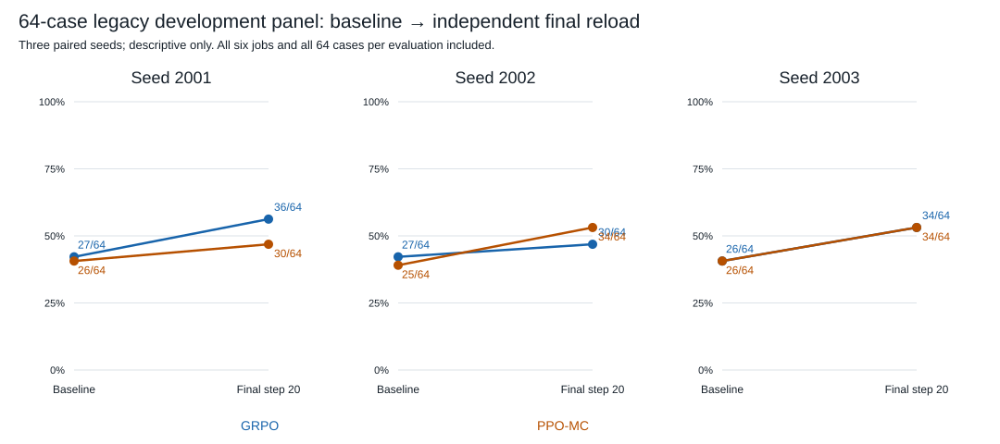

# Phase 2 r03 private-repository closeout — 2026-11-15

**Completed result:** all six study runs finished 20 actor optimizer calls and an independent final-checkpoint reload evaluation. All three PPO-MC runs also finished 20 critic calls. The existing local audit reconstructed completion for all 24 stages: six qualification stages and 18 study stages. No new model execution or evidence collection was needed for this closeout.

The experiment is `agl-explore-20-v1-r03`. Its exact executed source is **`5fb6adfd48ee245509f7dff3ab1d849fcf707d86`** ([source](https://github.com/amulyaparthasarathy/agent-lightning-lab/tree/5fb6adfd48ee245509f7dff3ab1d849fcf707d86)). Later documentation and merge commits did not generate these results and do not qualify a new live source identity. Historical plan digests, receipts and checkpoint identities remain unchanged.

## Result and denominator

Prepared Llama-3.2-3B-Instruct was trained from the same prepared base in each run. The training pool contains 256 questions. Each study run has **20 updates × 8 question presentations × 4 rollouts = 640 trajectories**; all six total 3,840. There are 160 question presentations per run, not a claim of 160 unique questions or 20 epochs. Each final checkpoint was independently reloaded and evaluated on all 64 cases of the reused **exploratory-legacy-64 development panel**. The three seed pairs reuse the panel; they are not 384 independent test questions.

| Algorithm | Seed | Baseline correct | Reload correct | Change (pp) | Actor / critic calls |
|---|---:|---:|---:|---:|---:|
| GRPO | 2001 | 27/64 | 36/64 | +14.062500 | 20 / 0 |
| PPO-MC | 2001 | 26/64 | 30/64 | +6.250000 | 20 / 20 |
| GRPO | 2002 | 27/64 | 30/64 | +4.687500 | 20 / 0 |
| PPO-MC | 2002 | 25/64 | 34/64 | +14.062500 | 20 / 20 |
| GRPO | 2003 | 26/64 | 34/64 | +12.500000 | 20 / 0 |
| PPO-MC | 2003 | 26/64 | 34/64 | +12.500000 | 20 / 20 |

| Algorithm | Mean baseline | Mean final | Mean improvement |
|---|---:|---:|---:|
| GRPO | 41.666667% | 52.083333% | +10.416667 pp |
| PPO-MC | 40.104167% | 51.041667% | +10.937500 pp |



Qualification seed 9101 is separate: GRPO 27/64 → 27/64 and PPO-MC 27/64 → 30/64, two actor calls per arm and two critic calls for PPO. It is excluded from study averages and the figure. Earlier Phase 1 results and failed attempts remain separate historical records.

**Conclusion:** both arms improved their recorded frozen-scorer endpoints in these three runs; the direction of the final GRPO–PPO difference changes across seeds. This small exploratory result establishes neither superiority nor equivalence, and it does not establish fresh-holdout generalization.

## Upstream contribution and lab changes

The paper and released Calc-X example supplied the Agent Lightning agent/trainer separation, interaction-to-training adapter, calculator task, AutoGen/MCP harness and numerical-answer reward. The repository's [existing source references and attribution](../experiment/README.md#primary-sources) and [matched backend](PHASE2_MATCHED_BACKEND.md) describe the pinned implementation. This lab adapted the example to prepared Llama, bounded Modal execution, frozen data/template/scorer identities and durable stage/checkpoint evidence. Phase 2 adds matched complete-rollout retention, equal-rollout generated-token reductions, GRPO and learned-critic PPO-MC, explicit seed streams, bounded scheduling, and independent final reloads. This is a lab adaptation, not a reproduction of all paper results.

Verified evidence is summarized in the [verification ledger](../evidence/phase2-r03/VERIFICATION.md), [scientific analysis publication copy](../evidence/phase2-r03/SCIENTIFIC_ANALYSIS.md), and [24-stage CSV](../evidence/phase2-r03/stage_receipts.csv). Recorded rewards use the frozen answer extractor and Calc-X comparison, not a new human or alternative semantic grade. The audit verified actual optimizer post-hooks, not just metric-row counts. Eight zero-current-gradient GRPO calls still count as optimizer calls; this does not prove every call changed weights.

Engineering interpretation is explicitly limited: matched retention and weighting reduce processing differences, but algorithm-specific RNG streams, asynchronous serving, formatting/tool errors and critic compute still complicate comparisons. PPO's decreasing critic loss is not proof of useful prediction: all 51 defined explained-variance measurements were negative, and the critic lost to the earlier-data constant predictor on all 57 comparable steps. Hypotheses about sparse rewards, formatting or critic noise remain untested.

Unverified features include a clean cold-build reproduction, independent new tensor/model/data rehashes, fresh-holdout performance, and the ten-job campaign/probe. The audit checked recorded checkpoint manifests and reload evidence; it did not download or independently load all checkpoint tensors. W&B identities/history/summaries reconciled; literal full config equality did not, because optimizer total steps resolve from local −1 to 2/20 and empty containers serialize differently.

## Cost and retention scope

The existing audit's **2026-11-15 14:12:18.783408 UTC** provider snapshot attributes **$5.76491115** to r03 qualification and **$34.33868457** to the study, totaling **$40.10359572**. These are as-of app charges, excluding earlier failed apps from this sum. They are not a final invoice or complete lifetime/storage/collection cost. The audit also preserves a $0.00499327 discrepancy in whole-workspace additive billing fields; no residual is allocated to r03 to make them balance.

The [evidence index](../evidence/phase2-r03/EVIDENCE_INDEX.md) gives source, raw-record and checkpoint locators. Git hosts only selected derived results and reviewed documentation. Raw collections remain under `.local/recovery-r03/` in the exploratory worktree; native checkpoint tensors remain in the existing private working Volume. This closeout creates no new raw-trace or weight backup. The older [preservation closeout](PRESERVATION_CLOSEOUT_2026-11-14.md) applies to its named Phase 1 artifacts, not automatically to r03. No branch, worktree, local evidence or checkpoint is deleted. Ongoing storage retention is not changed here.

## Offline use and integration checks

From the repository root, with Python 3.12 and no packages or credentials:

```bash
python3 scripts/check_phase2_results.py
```

This verifies the new bundle's byte hashes, six-run denominators and means, three signed contrasts, and consistency with all 24 derived stage summaries. It does not reconstruct unavailable raw trajectories, verify remote tensor bytes, or confer live qualification. Input/output hashes and publication-copy transformations are explicit in [manifest.json](../evidence/phase2-r03/manifest.json); original local audit files remain byte-for-byte intact. Private locator paths are not promised to resolve in a clone.

Actual commands, environment identities, test counts, expected skips and retained-test scope are recorded in [integration checks](../evidence/phase2-r03/INTEGRATION_CHECKS.md). Repository workflows and review/check state are inspected before push and again before merge. The authorized stack is [#24](https://github.com/amulyaparthasarathy/agent-lightning-lab/pull/24), [#25](https://github.com/amulyaparthasarathy/agent-lightning-lab/pull/25), then [#26](https://github.com/amulyaparthasarathy/agent-lightning-lab/pull/26), each targeting main at merge time with an ordinary merge commit.

## Disposition of previous review concerns

| Concern | Disposition and evidence |
|---|---|
| #24 a01 remote hydration imported missing `modal_app`; local detach was mistaken for completion | Addressed by `62f4de281737dc4e769a26339895a597b4aac32d`, real importer regressions, and later r03 completion. [Retained import evidence](../evidence/phase2-a02/import-regression.json); failed a01 remains preserved. |
| #24 two-job implementation did not supply ten-job scheduling or live campaign qualification | Scheduler dependency implemented in #25 at `d56581041b2fcd428d1e9e5e9ca6d915ba425264`. Only exploratory two-lane execution is evidenced here; the formal campaign remains UNEXECUTED/UNQUALIFIED. No old a02/pilot identity is rebound to r03. |
| #25 no-Volume probe still demands `volume_version == 2` | Documented unresolved limitation of the unexecuted probe: `matched_capacity.validate_capacity(..., storage=False)` retains that requirement. It must be reviewed before future probe/campaign use; not represented as fixed. |
| #25 Volume name, unsupported quotas/free-space fields, 3,072-GiB policy and $700 scenario versus observed allowance | Formal campaign limitations remain. The Volume suffix is not backend proof; quota/headroom fields need supported evidence, the storage threshold is lab policy, and cost scenarios are not invoices or provider hard limits. Gates remain unchanged. |
| #25 same-source pilot/admission and untouched 256-case holdout | Still prerequisites for that unexecuted route. r03 uses a separately versioned reused-panel exploratory design. No claim that eligible fresh data does not exist; a later campaign would need an authorized inventory and independence review. |
| #26 exploratory Volume/backend/free-space preflight concern | Addressed for the exploratory route by `35c5edb485e6c0cc12077eb9bd50246d8ff1709c` and later `cb246a0` bounded-admission changes. [Exploratory contract](PHASE2_EXPLORATORY.md) distinguishes verified V1, incremental output allowance, local scratch and unverified quota/cache fields. Formal campaign gates were not relaxed. |
| #26 original Transformers mismatch, r01 invalid rollout seed configuration, r02 overlong Unix IPC paths | Addressed respectively by `608a3e5`, `fa4dc93`, and executed `5fb6adf`; [a01](PHASE2_EXPLORATORY_A01_FAILURE.md), [r01](PHASE2_EXPLORATORY_R01_CONFIG_FAILURE.md), [r02](PHASE2_EXPLORATORY_R02_IPC_FAILURE.md) retain failures and regressions. All 24 r03 stages later passed the audit. |
| Earlier comments said keep drafts/source frozen pending execution | Completed r03 remains bound to its exact source; this closeout's owner instruction separately authorizes private integration. No scientific identity is regenerated. Author comments are not independent review approval. |

Merging the scheduler code retains an implemented dependency; it neither authorizes nor certifies the ten-job/ten-GPU campaign or untouched-holdout route. No unresolved formal-campaign limitation is marked resolved to obtain a clean dashboard.

The next milestone is the separate [public-readiness plan](PUBLIC_RELEASE_PLAN.md), not more training. The repository stays private.
