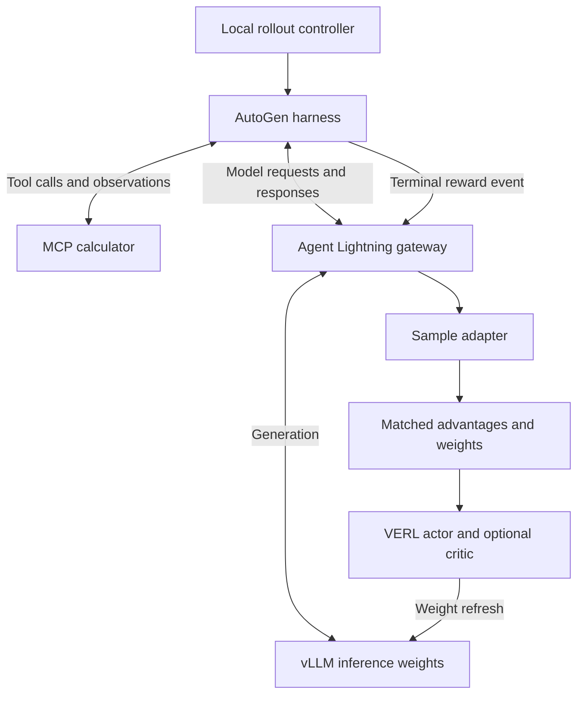

# 1. Why train through the real agent harness?

**Opening question: What changes when we train a calculator agent?**

The model learns which text and tool requests to generate. The calculator still evaluates expressions using its existing program. Training changes the actor's model parameters, and PPO-MC also changes a separate critic's parameters. It does not backpropagate through the calculator or rewrite AutoGen's orchestration code.

A useful training experience includes the consequences of a choice. The model can request the wrong calculation, receive a tool error, recover, or put a correct number in a format the scorer rejects. Running the actual harness preserves those consequences. A collection of isolated question/answer strings would omit much of that interaction.

## Separate the system from the learning method

These are teaching definitions, not additional experimental findings.

| Term | Meaning | Calculator example |
|---|---|---|
| Deterministic workflow | Code fixes control flow and action choices for given inputs | Always evaluate a supplied expression, then print its result |
| Compound AI system | Multiple model, retrieval or tool components cooperate | A model extracts an expression and a fixed program checks it |
| Agent | A model selects actions within a harness that manages tools, context and stopping | The model chooses a calculator request and then a response |
| Supervised fine-tuning (SFT) | Fit model outputs to supplied target demonstrations | Imitate a trusted tool-use transcript |
| Offline RL | Learn from a fixed collection of previously gathered interactions | Optimize using stored interactions without collecting new trajectories |
| Online RL | Collect new interactions from the evolving policy, then update it | Generate calculator attempts after each inference-weight refresh |

A fixed question pool does not make this experiment offline RL. The questions stay fixed, but the sampled experiences come from successively updated policies.

## Who owns each responsibility?

This is a responsibility map, not an instruction to start services. GRPO and PPO-MC are mathematical choices inside the training path, not additional servers.

| Component | Responsibility in this lab |
|---|---|
| AutoGen and MCP | Build messages, run the calculator and continue within bounded tool iterations |
| Agent Lightning gateway/proxy | Route model calls and associate model-request/reward events with rollout identities |
| Agent Lightning controller | Launch and monitor local harness processes inside a stage worker |
| Agent Lightning sample adapter/customized trainer | Convert captured calls into rows, retain attribution and coordinate training |
| vLLM | Serve generations using an inference copy of actor weights |
| VERL | Execute model forwards/backwards, optimizers, checkpointing and weight synchronization |
| GRPO / PPO-MC | Construct advantages using peer rewards or a learned value prediction |
| Custom matched overlay | Enforce complete-rollout retention, real-rollout weighting, one update per collection and audit hooks |

The prepared actor is **`meta-llama/Llama-3.2-3B-Instruct`**, already instruction-tuned before this lab's RL. The pinned upstream Calc-X starter defaults to **Qwen2.5-1.5B-Instruct**. The paper's search, instruction-following and coding results use their own tasks and protocols. None is the six-run Calc-X comparison.

## Follow the source

Start with [`Agent.run`](https://github.com/amulyaparthasarathy/agent-lightning-lab-public/blob/89fe32f92f29209803c13264baed951713741d42/experiment/observed_calc_agent.py#L301), then [`launch.make_plan`](https://github.com/amulyaparthasarathy/agent-lightning-lab-public/blob/89fe32f92f29209803c13264baed951713741d42/experiment/launch.py#L216) for gateway/controller configuration. [`matched_runtime.register_in_worker`](https://github.com/amulyaparthasarathy/agent-lightning-lab-public/blob/89fe32f92f29209803c13264baed951713741d42/experiment/matched_runtime.py#L263) shows the process-local overrides, and [`matched_launch.configuration`](https://github.com/amulyaparthasarathy/agent-lightning-lab-public/blob/89fe32f92f29209803c13264baed951713741d42/experiment/matched_launch.py#L49) wires them into workers. The [pinned starter configuration](https://github.com/microsoft/agent-lightning/blob/cbc56e41e0eab643aa71d195e92e5bba652fa683/examples/calc_x/train_calc_agent.py#L13) is attribution, not the final study recipe.

The [Agent Lightning v1.0 report](https://arxiv.org/html/2608.17528v1), Appendix A, supplies the broader integration design. Actual service choices here are established by the pinned lab code.

## Evidence and limits

The [r03 closeout](../PHASE2_CLOSEOUT_2026-11-15.md) records successful training and independent reload evaluation. It does not benchmark a direct-VERL alternative or demonstrate an enterprise agent. Two H100 lanes ran independent single-GPU jobs. Concurrent harness requests do not make this an asynchronous-RL experiment: the launcher disables asynchronous rollout training.

## Offline exercise and answer

**Exercise:** The training pool is fixed. The actor is updated and new tool-use attempts are sampled. Is this SFT, offline RL or online RL? Which program learns to multiply?

**Answer:** Online RL, because new interaction data comes from the evolving policy. The model learns action choices and output behavior; the calculator's multiplication program is unchanged. SFT would use target demonstrations, while offline RL would train on fixed past interactions.

Next: [follow one calculator task](02-follow-one-calculator-task.md). See also the [glossary](glossary.md) and [source map](source-map.md).
