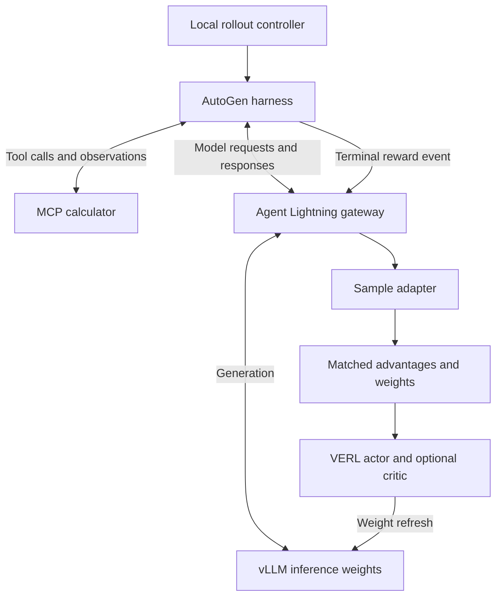

# 1. Why train through the real agent harness?

Suppose you ask a language model, “What is `(7+5)*3`?” It can write an answer, or it can ask a calculator for help. The goal of training for agent use is to make useful choices more likely in situations like this one. Training adjusts the model's **parameters**, its numerical weights. The model making those choices is the **actor**. Its rule for choosing what to generate from the input so far is its **policy**.

## Who owns the next step?

The **environment** is the world the actor interacts with. Here it includes a task and a calculator **tool**, a program that accepts an expression and returns a result. The actor can generate a request to evaluate `(7+5)*3`. The calculator computes `36`. That returned value is an **observation** the actor can use when it writes its answer.

Someone has to put that observation into the next model input. The **harness** is the application code that manages the exchange. It builds the first prompt, makes the tool available, dispatches the requested call, adds its result or error to the conversation history, and decides when to ask for another response or stop. That history is part of the **state** of the interaction. A trainer given only the question and final answer would miss the request the actor made and the observation it had when answering.

If code always sends the expression to the calculator and prints the result, that's a **deterministic workflow**. A **compound AI system** can include a model that extracts the expression and a calculator that evaluates it, still in a fixed order. In an **autonomous agent**, the model gets to choose the next action within the harness's limits. Here that choice might be to call the tool or to give a final answer.

## Two ways to teach the same task

Chat training can use a long conversation. What changes when tools enter the loop is that a model action can change the environment or reveal information, and that consequence becomes part of the next input. The quality of a tool request may only become apparent when the task ends.

| Training method | Learning to respond in a chat | Learning to act with the calculator |
|---|---|---|
| **Supervised fine-tuning (SFT)** learns from target behavior. | Given the conversation, increase the probability of the words in a selected reply. | Given a demonstration, train on the selected model outputs, such as a good tool request and a good final answer. The calculator's reply supplies context for predicting the answer. The choice of target positions determines what is imitated. |
| **Reinforcement learning (RL)** learns from sampled behavior and rewards. | Sample a reply and use feedback on its quality to adjust the policy. | Let the actor choose a request, see the result and answer. A **verifier** compares the final answer with a separately supplied expected result. Its score, the **reward**, arrives at the end of the attempt. |

A completed attempt is an **episode**. The sequence of inputs, actions and observations through its outcome is its **trajectory**. Sampling one attempt is called a **rollout**. In the calculator study the questions came from a fixed pool, but the trainer collected fresh trajectories from the evolving policy. This is *online RL*. Offline RL would use an already collected set of interactions.

For SFT, choosing the demonstration targets and choosing which parameters to update are separate decisions. One can train all weights, select some existing weights, or train small added matrices using low-rank adaptation (LoRA).

The calculator study compares group relative policy optimization (GRPO) with a Monte Carlo version of proximal policy optimization (PPO-MC). Both update the actor's weights. PPO-MC also trains a separate **critic** to predict the eventual reward. The verifier supplies the actual score. The calculator program, prompt-building code and scoring rule stay fixed throughout training.

## Where Agent Lightning fits

With a trainer-owned interaction loop, the trainer constructs each next model input itself. Here the harness owns the loop. The trainer needs a way to recover what the actor actually saw and generated on *each call*, and which attempt earned the final reward.

| When | Component and responsibility |
|---|---|
| Start an attempt | Agent Lightning's local controller starts the harness. AutoGen manages the conversation and uses the Model Context Protocol (MCP) to call the calculator. |
| Generate an action | Agent Lightning's gateway and proxy route the model request to vLLM, the generation service that runs a copy of the actor's weights. The requests and responses are associated with the attempt. |
| Finish and prepare data | The harness posts the verifier's reward for the attempt. Agent Lightning's rollout manager and sample adapter connect that outcome to the captured calls and turn them into training rows. |
| Train and serve again | The lab's matched training code keeps complete attempts and gives each equal total weight. VERL, the training backend, computes how its loss (the quantity being minimized) varies with the weights. The optimizer uses those gradients to adjust the weights. Updated actor weights are copied to the generation service for later attempts. |

Trace the components in the calculator implementation

The study used the instruction-tuned Llama 3.2 3B actor. The pinned upstream starter defaults to Qwen2.5-1.5B-Instruct. For the executed setup, follow [the calculator harness](https://github.com/amulyaparthasarathy/agent-lightning-grpo-ppo/blob/89fe32f92f29209803c13264baed951713741d42/experiment/observed_calc_agent.py#L301), [gateway and controller configuration](https://github.com/amulyaparthasarathy/agent-lightning-grpo-ppo/blob/89fe32f92f29209803c13264baed951713741d42/experiment/launch.py#L216), and [matched worker registration](https://github.com/amulyaparthasarathy/agent-lightning-grpo-ppo/blob/89fe32f92f29209803c13264baed951713741d42/experiment/matched_runtime.py#L263). The [source map](source-map.md) distinguishes the lab implementation from the upstream design and paper.

**Check your understanding.** The tool returned the right number, yet the actor wrote the wrong answer. Which component would you train from this attempt? The actor chose what to write after seeing the number. Its output is behavior the trainer can adjust. The calculator already did the requested arithmetic.

Continue to [Follow one calculator task](02-follow-one-calculator-task.md) and decide exactly when it earns a reward.
