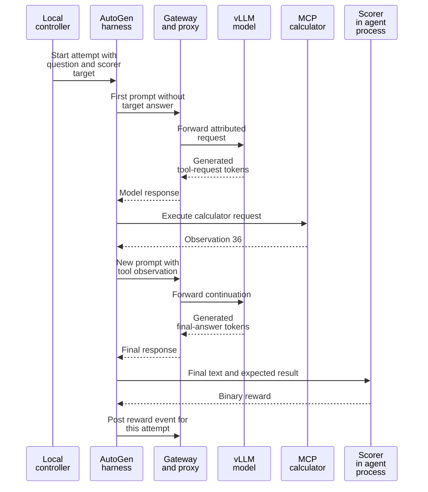

# 2. Follow one calculator task

Trace `(7+5)*3` through one complete episode to see how two model choices and one tool result become a single scored training experience.

**Predict before you run anything.** Suppose the calculator returns `36`. Has the attempt earned its reward yet? Which number will the verifier check?

## Follow the two model calls

This is a **synthetic trajectory**. The task, request and responses below were chosen for teaching. The table uses readable notation for the calculator call. The actual program accepts an expression string. [Calculator tool contract](../../experiment/reader_calculator.py)

| Step | Who acts? | What happens in this attempt? |
|---|---|---|
| 1. Set the task | Environment and harness | The task supplies the question `What is (7+5)*3?` and the expected result `36` separately. The harness gives the model the question, the answer-format instructions and the available tool. The verifier gets the expected result. |
| 2. Choose an action | **Model, first call** | Generates a request for `calculate` with arguments `{"expression": "(7+5)*3"}`. This is a choice about what to calculate. |
| 3. Execute the request | **Calculator tool** | Evaluates the expression and returns the observation `36`. A successful call establishes that the tool did its job. |
| 4. Build the next input | Harness | Includes the previous request and its observation in the conversation for a second model call. This time the model can see the returned number. |
| 5. Give the answer | **Model, second call** | Generates the final response `### ANSWER: 36 ###`. This is another action by the same actor. |
| 6. Score and record | Verifier and harness | Extract `36` from the final text and compare it with the expected result. They match, so the harness posts a terminal reward of `1.0` for this attempt. |

The number `36` appears in three roles. In the calculator reply it is information for the model. In the final answer it is the model's claim. In the task record it is the verifier's independent reference. **The reward depends on the claim compared with the reference.** The calculator could do its job perfectly and the actor could still copy the wrong number.

## Check the endpoint in Python

Use Python 3.12 and a Unix shell. If you need a checkout, follow the [repository setup](../../README.md#credential-free-offline-quick-start). Paste this block from the repository root, the directory containing `experiment/`. It needs only the standard library. It uses Python arithmetic for the calculator observation and supplies the model's final text by hand. For this marked answer, strip the literal delimiters and compare the numbers with the same relative tolerance as the live scorer. The live harness also handles other answer formats.

```bash
python3 - <<'PYTHON'
from math import isclose

expected = 36                       # task record, available to the verifier
observation = (7 + 5) * 3           # value returned to the model in our example
final_text = "### ANSWER: 36 ###"   # synthetic model output

answer = final_text.removeprefix("### ANSWER: ").removesuffix(" ###")
reward = float(isclose(float(answer), expected, rel_tol=0.01))
print("tool observation:", observation)
print("model answer:", answer)
print("episode reward:", reward)
PYTHON
```

The output matches the attempt in the table.

```text
tool observation: 36
model answer: 36
episode reward: 1.0
```

## What goes to training?

Imagine storing just `(question, 36, 1.0)`. That would lose the model's first choice and the input that made its second choice possible.

On a live rollout the gateway captures the prompt and sampled response for each call, including the actual token IDs (numbers representing pieces of text). The rollout manager groups both calls under one rollout ID. For our example, the first call would have no individual reward. The last call would carry `1.0`, also stored as the final reward of the rollout.

The adapter can now build training rows that preserve what the model saw before each action. The tool observation conditions the later answer. Only generated action positions contribute directly to the policy loss, the quantity the trainer optimizes. [Rollout manager](https://github.com/microsoft/agent-lightning/blob/cbc56e41e0eab643aa71d195e92e5bba652fa683/agentlightning/verl/agl_rollout_manager.py#L470) · [Training rows and masks](03-trajectories-tokens-and-fragments.md#follow-the-synthetic-task-into-token-space)

One reward does not say how good the request was in isolation. The trainer estimates an **advantage**, how well the sampled behavior did relative to a baseline. GRPO compares rewards from several attempts at the same question. PPO-MC compares the outcome with the critic's prediction. The optimizer uses the resulting loss across a collection of attempts to adjust model weights. That can change the probability of requesting this calculation or giving this answer the next time the model sees a similar history. [GRPO advantages and loss](04-grpo-step-by-step.md) · [PPO-MC advantages and loss](05-ppo-mc-step-by-step.md) · [Optimization and weight refresh](06-one-complete-training-update.md)

<details>
<summary>Follow the same steps in the recorded experiment's source</summary>



The calculator harness reads `QUESTION` and `RESULT` separately. It appends answer-marker instructions to the question and runs AutoGen with reflection after tool use and at most two tool iterations. The first matching answer marker supplies the extracted text. If there is no match, the scorer gets the stripped final response. The original scalar comparator accepts an exact string match and uses relative tolerance `1e-2` for numeric comparison. The harness posts the score to the attempt's event endpoint. [Study harness and scoring](https://github.com/amulyaparthasarathy/agent-lightning-grpo-ppo/blob/89fe32f92f29209803c13264baed951713741d42/experiment/observed_calc_agent.py#L301) · [Calc-X scalar comparison](https://github.com/microsoft/agent-lightning/blob/cbc56e41e0eab643aa71d195e92e5bba652fa683/examples/calc_x/eval_utils.py#L43)

The harness also records readable model and tool events for inspection. Training uses the gateway's token data. The public calculator audit reports measured rewards and formatting outcomes on the study cases. Its published summaries do not contain this illustrative dialogue. [Model and tool recorder](https://github.com/amulyaparthasarathy/agent-lightning-grpo-ppo/blob/89fe32f92f29209803c13264baed951713741d42/experiment/observed_calc_agent.py#L236) · [Calculator scientific analysis](../../evidence/phase2-r03/SCIENTIFIC_ANALYSIS.md)

</details>

Two calls can occupy separate training rows while still belonging to a single attempt. To see why counting rows would give some attempts too much influence, run the [synthetic accounting example](../../experiment/cpu_accounting_demo.py) from the same repository root.

```bash
python3 experiment/cpu_accounting_demo.py
```

In its JSON output, compare `unsplit` with `fragmented`. The simple mean over rows (`global_row_mean_loss`) goes from `5.0` to `3.5`. Giving each original attempt equal weight (`equal_rollout_token_mean_loss`) gives `5.0` both times. This second fixture uses predefined losses. Neither exercise generates model responses or measures learning.

**Optional alteration.** Change only `final_text` to `"### ANSWER: 35 ###"` and rerun the endpoint check. The tool observation still prints `36`. The model answer becomes `35` and the episode reward becomes `0.0`. Both versions are completed attempts.

Continue to [Chapter 3 · Trajectories, tokens and fragments](03-trajectories-tokens-and-fragments.md) to mark the model's actions in the training rows.
