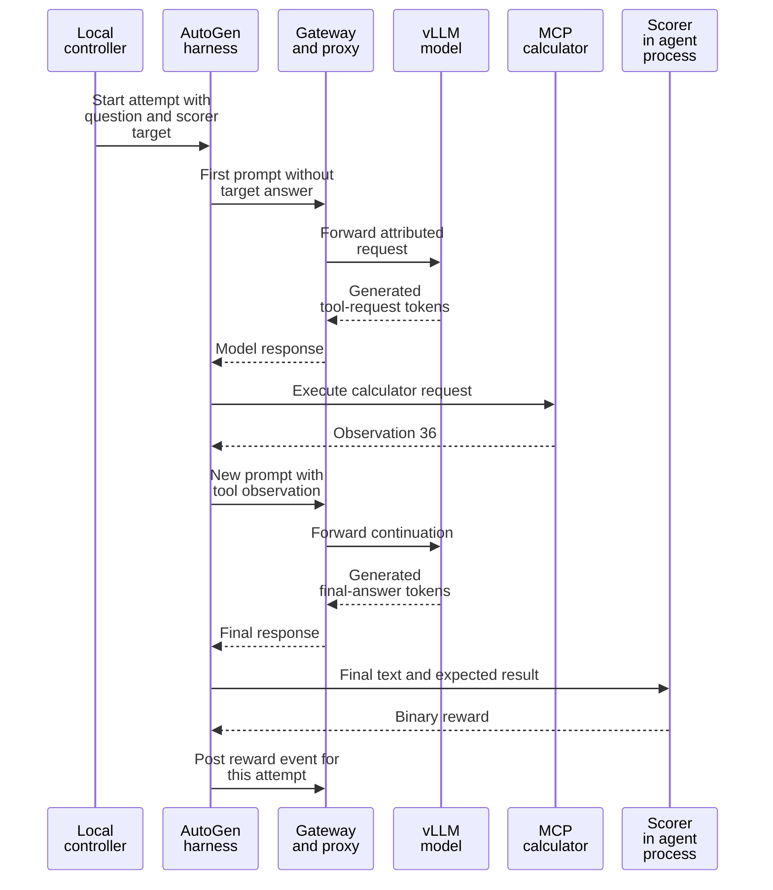

# 2. Follow one calculator task

**Opening question: How does a question become a reward attached to one experience?**

A rollout is one attempt at solving a task, including model-generated tool requests, returned observations and the final response. The scorer judges the endpoint after the harness finishes. A successful calculator invocation alone does not earn the task reward.

## A synthetic transcript

Everything in this example is **synthetic**, including the chosen tool request and final response. It is not one of the recorded r03 rollouts. Tool requests are described in words because this lesson does not assert an exact observed MCP argument schema.

- Question: `What is (7+5)*3?`
- Expected numeric result, supplied to the scorer: `36`.
- Possible final response: `### ANSWER: 36 ###`.

| Event | Illustrative content | What it means |
|---|---|---|
| Task input | `What is (7+5)*3?` plus answer-marker instructions | The expected result is absent from the constructed question prompt |
| First model call | System/instruction messages, task, calculator-tool information | The harness constructs this call's context |
| Generated action | Request the calculator to evaluate `(7+5)*3` | Generated request tokens are policy actions |
| MCP observation | Calculator returns the numeric result `36` | Tool output is context, not a model-generated action |
| Later model call | Task and conversation history, including request and observation | A newly rendered/tokenized prompt conditions the continuation |
| Generated final answer | `### ANSWER: 36 ###` | These generated tokens are actions too |
| Extract and compare | Extract `36`, compare with the expected result | Produces terminal binary reward $R_\rho=1$ |
| Reward event | Post reward for the current rollout attempt | Makes the outcome available to training |

Here $\rho$ identifies one complete rollout. $R_\rho$ is its recorded terminal reward, either 0 or 1. A model call is only one part of that rollout.

The expected result exists in the agent process for scoring. It is not included in the question prompt constructed in `Agent.run`. That source observation is narrower than claiming an isolated security boundary against every possible malicious harness.

## What actually happens in the code?

[`Agent.run`](https://github.com/amulyaparthasarathy/agent-lightning-grpo-ppo/blob/89fe32f92f29209803c13264baed951713741d42/experiment/observed_calc_agent.py#L301) reads the question and expected result separately. It appends answer-format instructions to the question, starts `mcp_server_calculator`, and creates an AutoGen `AssistantAgent` with `reflect_on_tool_use=True` and at most two tool iterations. The model may follow a different sequence from this illustrative two-call path.

[`ObservedClient.create`](https://github.com/amulyaparthasarathy/agent-lightning-grpo-ppo/blob/89fe32f92f29209803c13264baed951713741d42/experiment/observed_calc_agent.py#L236) records model-call inputs, outputs and available usage. [`ObservedWorkbench.call_tool`](https://github.com/amulyaparthasarathy/agent-lightning-grpo-ppo/blob/89fe32f92f29209803c13264baed951713741d42/experiment/observed_calc_agent.py#L272) records execution and errors, including returned `is_error` results. These readable records do not replace the gateway's training token data.

After the final message, `Agent.run` extracts the first matching `### ANSWER:` span using its frozen regular expression, or falls back to the raw final response if no match exists. It invokes the original Calc-X scalar comparator with tolerance `1e-2` and posts a reward event. The [pinned original agent](https://github.com/microsoft/agent-lightning/blob/cbc56e41e0eab643aa71d195e92e5bba652fa683/examples/calc_x/calc_agent.py#L18) supplies the scorer/harness lineage.

The rollout manager's [`_create_rollouts`](https://github.com/microsoft/agent-lightning/blob/cbc56e41e0eab643aa71d195e92e5bba652fa683/agentlightning/verl/agl_rollout_manager.py#L380) and [`_build_completed_rollout`](https://github.com/microsoft/agent-lightning/blob/cbc56e41e0eab643aa71d195e92e5bba652fa683/agentlightning/verl/agl_rollout_manager.py#L470) connect question/group identity, model-call triplets and final rewards. This is how the result reaches the correct training experience.

## Evidence and limits

The [scientific analysis](../../evidence/phase2-r03/SCIENTIFIC_ANALYSIS.md) reports complete posted rewards for study trajectories and evaluation episodes. The selected Git bundle does not supply their raw transcripts. It records frozen-scorer outcomes, not independent semantic grading or a causal account of the model's choices.

A calculator can return `36` and the episode can still fail if the final answer is `### ANSWER: 35 ###`. A missing marker also affects extraction, but the fallback means marker absence is not an unconditional rule that reward must be zero. In the recorded r03 evidence, all missing-marker episodes did receive zero.

## Offline exercise and answer

**Exercise:** Label the tool request, the calculator's `36`, and the final answer as action or observation. If the final response is `### ANSWER: 35 ###`, does the successful tool call force reward 1?

**Answer:** The generated request and final answer are actions. The calculator's returned `36` is an observation. The wrong extracted final answer receives reward 0; the tool call does not override it.

Next: [trajectories, tokens and fragments](03-trajectories-tokens-and-fragments.md).
