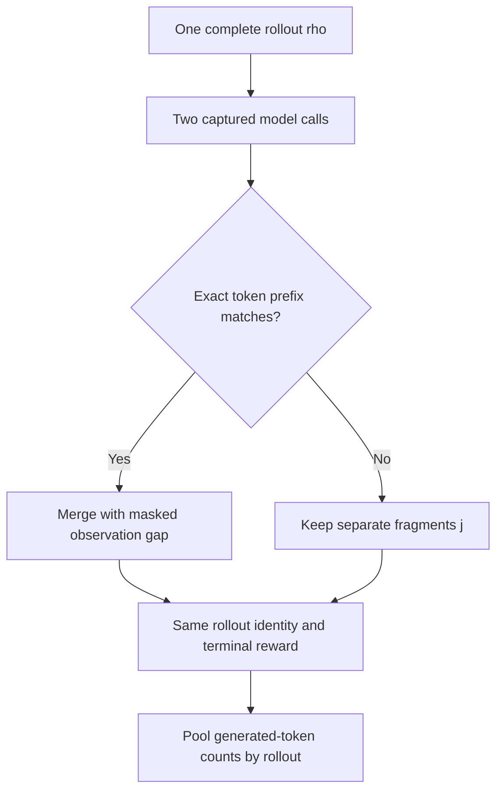

# 3. Trajectories, tokens and fragments

**Opening question: Why can one calculator experience become several tensor rows?**

A training row must preserve the context in which its response was sampled. The model sees token IDs produced by a tokenizer and chat template for each call. Decoding and then retokenizing the same text need not reproduce the sampled IDs. Merging calls is safe only when their actual token prefixes agree.

## Follow the synthetic task into token space

For the synthetic `(7+5)*3` task, keep these regions separate. This strip is conceptual, not measured Llama tokenization.

```text
question/instructions | generated tool request | calculator observation | generated answer
    action mask 0     |       mask 1           |        mask 0         |       mask 1
```

The generated tool request is an action even if a parser turns it into structured arguments. Returned tool text is an observation even when it appears inside the response-shaped portion of a merged row. The response mask selects action terms. Mask 1 means included in loss, not positively rewarded.

Here is an invented token-ID example, independent of a real tokenizer. Call 1's prompt is `[10,11]`, and it samples `[20,21]`. If call 2's prompt starts `[10,11,20,21,30]`, it extends the exact prefix. The adapter can append observation token `[30]` with mask 0 and the next generated response with mask 1. If call 2 instead starts `[10,11,22,30]`, the adapter must start another fragment. Replacing `[22]` with the old sampled IDs would change the context used for the second response.



## Keep the counting units separate

| Unit | Identity or role |
|---|---|
| Question/group $q$ | One question presentation whose four attempts form a comparison group |
| Complete rollout $\rho$ | One sampled attempt, possibly with several model/tool calls |
| Fragment $j$ | A training row representing part of that rollout with valid context |
| Generated token $t$ | A sampled model action, including tool-call syntax and final-answer text |
| Microbatch | A memory-sized portion used for a forward/backward pass |
| Optimizer collection | All retained rows from 32 real rollouts in one matched iteration |

A dataset case ID can recur in later presentations. Group identity controls the GRPO comparison; rollout identity controls reward attribution and total loss weight. Three fragments from a successful attempt remain one successful attempt.

## Equal weight for each real rollout

Define $m_{\rho,j,t}$ as 1 for a generated action and 0 for context/padding. Let

$$
L_\rho=\sum_{j,t}m_{\rho,j,t},\qquad
w_{\rho,j,t}=\frac{m_{\rho,j,t}}{N L_\rho}.
$$

$L_\rho$ counts generated tokens across the complete rollout. $N$ counts real rollouts. In a study iteration, $N=8\times4=32$, regardless of row count. A rollout with 120 generated tokens split into fragments of 40 and 80 has per-token weight $1/(32\times120)=1/3840$. Its weights sum to $1/32$.

For per-token surrogate loss $\ell_{\rho,j,t}$, the matched objective sums $w\ell$. It averages tokens inside each rollout, then averages rollouts. This deliberately normalizes length; it differs from an unnormalized episodic sum of action gradients.

Tool observations can affect gradients of later generated-token predictions through attention and conditioning. They have no direct action-loss term of their own. Padding also has zero weight.

## Source path and representation checks

The pinned adapter's [`ids_startswith`](https://github.com/microsoft/agent-lightning/blob/cbc56e41e0eab643aa71d195e92e5bba652fa683/agentlightning/verl/rollout_adapter.py#L55) and [`RolloutAdapter.get_train_data_batch`](https://github.com/microsoft/agent-lightning/blob/cbc56e41e0eab643aa71d195e92e5bba652fa683/agentlightning/verl/rollout_adapter.py#L456) handle prefix comparison, fragments and masks. The [paper's §2.1](https://arxiv.org/html/2608.17528v1#S2.SS1) provides design context; these exact functions determine the implementation.

The lab's [`instrument_adapter`](https://github.com/amulyaparthasarathy/agent-lightning-grpo-ppo/blob/89fe32f92f29209803c13264baed951713741d42/experiment/matched_runtime.py#L209) checks generated-token completeness, binary rewards, unique rollouts, valid prompts and four distinct rollouts per group. Missing/truncated data rejects the collection. [`patch_train_step`](https://github.com/amulyaparthasarathy/agent-lightning-grpo-ppo/blob/89fe32f92f29209803c13264baed951713741d42/experiment/matched_runtime.py#L83) removes legacy row dropping; [`rollout_weights` and `normalize`](https://github.com/amulyaparthasarathy/agent-lightning-grpo-ppo/blob/89fe32f92f29209803c13264baed951713741d42/experiment/matched_runtime.py#L102) use real-rollout totals.

The actor loss receives already weighted advantages. Do not multiply those advantages by $w$ again. The critic receives its own weight tensor. Chapter 6 follows both paths.

## Evidence and limits

The [audit publication copy](../../evidence/phase2-r03/SCIENTIFIC_ANALYSIS.md) reports complete retention and fragment/token reconciliation. Raw tensor diagnostics are bounded to the first four fragment rows. The selected bundle cannot independently replay every token.

[`ppo_math.normalize_actor`](https://github.com/amulyaparthasarathy/agent-lightning-grpo-ppo/blob/89fe32f92f29209803c13264baed951713741d42/experiment/ppo_math.py#L72) is a standalone historical port using row count. It is **not** final matched weighting. A synthetic arithmetic demonstration likewise proves an identity, not runtime integration or improved policy quality.

## Offline exercise and answer

Run from the repository root:

```bash
python3 experiment/cpu_accounting_demo.py
```

The [existing fixture](https://github.com/amulyaparthasarathy/agent-lightning-grpo-ppo/blob/89fe32f92f29209803c13264baed951713741d42/experiment/cpu_accounting_demo.py#L14) uses two synthetic rollouts with predefined losses, separate from our four-attempt calculator illustration.

**Exercise:** Why does the row mean change when rollout A splits into three rows, while the equal-rollout token mean stays fixed? What if our 120-token rollout splits again?

**Answer:** A's mean token loss is 2 and B's is 8, giving equal-rollout mean 5. Splitting A yields row means 1, 2, 3 and 8, with uniform row mean 3.5. The token losses did not change. The matched 120-token rollout still has total weight $1/32$, however many fragments represent those same tokens and contexts.

Next: [GRPO step by step](04-grpo-step-by-step.md).
