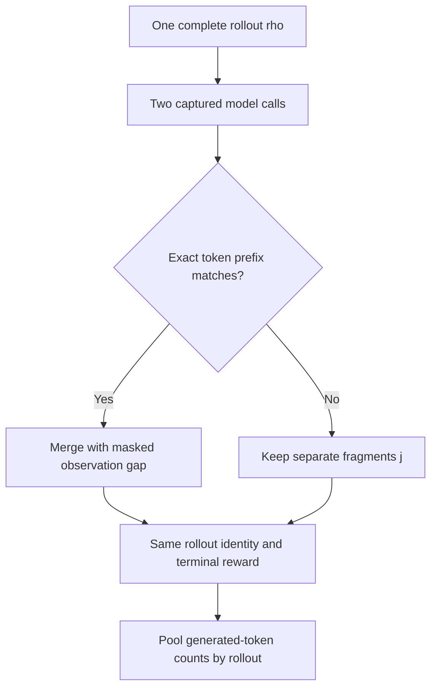

# 3. Trajectories, tokens and fragments

Turn the [calculator episode](02-follow-one-calculator-task.md) into training rows. By the end you should be able to point to the model output that predicts the first token of the final answer, and account for every generated token exactly once.

## Follow the synthetic task into token space

In our example, the actor requested `calculate({"expression": "(7+5)*3"})`, saw the calculator return `36`, then wrote `### ANSWER: 36 ###`. The verifier gave the episode a reward of 1. The harness called the model twice. Each time, the model saw a different history.

A **token** is a unit of model input or output, represented by an integer ID. A chat template formats messages and tool information before tokenization. We'll use short, **invented IDs** for the whole formatted exchange so you can trace it by hand. Brackets show lists in order. None of these numbers is a measured Llama token ID.

| Model call | History supplied to this call (prompt IDs) | Newly generated response IDs |
|---|---|---|
| 1. Request a calculation | `[10, 11]` stands for the instructions, question and available tool | `[20, 21]` stands for the tool request |
| 2. Write the answer | `[10, 11, 20, 21, 30]` includes the earlier request and the tool observation, represented by `30` | `[40, 41]` stands for the marked final answer |

**Predict.** Which input position supplies the prediction for target `40`? When `20, 21` appear in the second prompt, how many *new* sampled actions do they represent?

## Line up each prediction with its target

A causal language model reads the history through position `i` and predicts the token at position `i + 1`. During training we already have the sampled sequence, so we can place it beside itself, shifted by one position. A **next-token target** is the observed token whose probability we look up at that position. In RL, the later advantage calculation determines how that probability enters the update.

Here the second prompt starts with the entire first prompt and request. We can display the episode as one sequence. Read each column downward. The upper token names the **last** token visible to that prediction, with all earlier tokens in the same row still in context.

| Position in the input (starting at 0) | 0 | 1 | 2 | 3 | 4 | 5 |
|---|---:|---:|---:|---:|---:|---:|
| Last input ID seen | 10 | 11 | 20 | 21 | 30 | 40 |
| Next ID (target) | 11 | 20 | 21 | 30 | 40 | 41 |
| Source of target | prompt | actor | actor | tool | actor | actor |
| Include target in policy loss? | 0 | 1 | 1 | 0 | 1 | 1 |

The output at position 4, just after the model has read observation `30`, scores target `40`. The output *at* `40` scores `41`. We have no following target for the final input `41`. A **mask** is a list of inclusion flags. A 1 means this target participates in the policy loss even if the episode earned reward 0. Read the flag for the *target*, even when the input to its left came from the tool. The model can use the observation to predict a better answer while the observation itself has zero direct weight in the loss.

### Check the two original calls

From the repository root, paste this block into a Unix shell with Python 3.12. It uses lists from the table and the standard library. Check each call separately first, before combining any histories.

```bash
python3 - <<'PYTHON'
question = [10, 11]
request = [20, 21]
second_prompt = [10, 11, 20, 21, 30]
answer = [40, 41]

for call, prompt, generated in [(1, question, request), (2, second_prompt, answer)]:
    ids = prompt + generated
    is_action = [0] * len(prompt) + [1] * len(generated)
    pairs = []
    for i in range(len(ids) - 1):
        if is_action[i + 1]:
            pairs.append((ids[i], ids[i + 1]))
    print("call", call, pairs)

old_prefix = question + request
print("exact prefix:", second_prompt[:len(old_prefix)] == old_prefix)
PYTHON
```

Each printed pair gives the last input ID and the generated target ID.

```text
call 1 [(11, 20), (20, 21)]
call 2 [(30, 40), (40, 41)]
exact prefix: True
```

The request contributes two targets on call 1 and none on call 2. Marking all tokens that *look like* model text in the second prompt would charge the first decision twice. Target ownership follows the call that generated the token. A newly sampled token can still be a valid target even if its ID happens to equal one seen earlier.

## When do the calls share a row?

The gateway captures the actual prompt IDs, sampled response IDs and the sampled tokens' log probabilities (the logarithms of their probabilities at generation time). The adapter compares IDs directly. Turning the messages back into text and tokenizing them again can change boundaries around a tool result or role marker.

- **Exact prefix.** Keep prompt `[10, 11]` and its original generated request. Append only the gap `[30]` and the new answer. Before padding, the row's response is `[20, 21, 30, 40, 41]` and its response mask is `[1, 1, 0, 1, 1]`. The sampled log probabilities stay aligned with the four ones. When batching rows of different lengths, the adapter also masks out padding.
- **Different prefix.** Close the first row and start another with the second call's actual prompt and answer. Each row is a **fragment** of the same episode. In the second row the earlier request is prompt context, and only the two answer IDs are response targets.

The adapter stores its response mask on the **response IDs**. The longer table above includes a prompt target as well to show how alignment works. VERL selects the output one position before each response target, starting at the last prompt position. The response mask then selects the generated targets within that slice. [Pinned adapter merge and split](https://github.com/microsoft/agent-lightning/blob/cbc56e41e0eab643aa71d195e92e5bba652fa683/agentlightning/verl/rollout_adapter.py#L626) · [VERL next-token labels](https://github.com/verl-project/verl/blob/7aed6b230776f963fa09509c10d9c3a767d1102c/verl/workers/engine/fsdp/transformer_impl.py#L965) · [VERL response slice](https://github.com/verl-project/verl/blob/7aed6b230776f963fa09509c10d9c3a767d1102c/verl/workers/utils/padding.py#L137)



For the same prefix question in a service-based training loop, see the [Tinker sequence-extension tutorial](https://tinker-docs.thinkingmachines.ai/tutorials/advanced/sequence-extension/).

## Equal weight for each real rollout

A rollout ID identifies one sampled attempt. Splitting its calls across two rows gives us two histories to train on, but only one attempt and one terminal outcome. A question group has a different identity. It groups separate attempts at the same question for comparison in Chapter 4. A **microbatch** is just a collection of rows small enough to process together.

Suppose we average one number per row. Would splitting a single rollout give it more influence? From the same repository root, run the existing [CPU accounting example](../../experiment/cpu_accounting_demo.py) with Python 3.12. It uses two separate synthetic rollouts, A and B, with predefined token losses. Read the `unsplit` and `fragmented` sections of its JSON output.

```bash
python3 experiment/cpu_accounting_demo.py
```

| Expected values | `unsplit` | `fragmented` |
|---|---:|---:|
| Rows for A, then B | 1, 1 | 3, 1 |
| `global_row_mean_loss` | 5.0 | 3.5 |
| `equal_rollout_token_mean_loss` | 5.0 | 5.0 |
| A's share in `equal_rollout_weights` | 0.5 | 0.5 |

A's six token losses are `[1, 1, 2, 2, 3, 3]` and B's are all 8. Averaging within each rollout gives means of 2 and 8, then a mean of 5 across rollouts. After A splits, the four row means are 1, 2, 3 and 8. Averaging those would give A three votes and B one. Pooling by rollout ID preserves each attempt's share.

In the matched study, let $N$ count real rollouts, $j$ index fragments of rollout $\rho$, and $t$ index positions in a fragment's response. Write $m_{\rho,j,t}$ for the mask bit (1 for a generated target, 0 for context or padding). Summing it gives the generated-token count $L_\rho$ for the whole attempt. The coefficient on each token's loss is

$$
L_\rho=\sum_{j,t}m_{\rho,j,t},\qquad
w_{\rho,j,t}=\frac{m_{\rho,j,t}}{N L_\rho}.
$$

One study collection has eight questions times four rollouts, so $N=32$. A rollout with 120 generated tokens gives each target weight $1/(32\times120)=1/3840$. Two fragments with 40 and 80 generated tokens together receive $120/3840=1/32$. The lab applies the actor weight once through its advantages and supplies a separate weight tensor for the critic. [Matched rollout weights and normalization](https://github.com/amulyaparthasarathy/agent-lightning-grpo-ppo/blob/89fe32f92f29209803c13264baed951713741d42/experiment/matched_runtime.py#L102)

**Optional alteration.** In the first command, change only the second ID of `second_prompt` from `11` to `12`. Predict the output, then rerun it. Both lists of target pairs stay the same and `exact prefix` becomes `False`. The changed history would force a second fragment. There are still four sampled targets and one rollout. The pairs show only the last input ID, so equal pairs do not imply equal probabilities under the two different histories.

## Evidence and limits

The toy IDs and predefined losses explain the mechanics without loading a tokenizer or running a model. In the actual study the matched code checked each rollout's generated-token count against the sum of its response masks and rejected incomplete collections. The public audit reports complete retention and bounded tensor diagnostics from the first four fragment rows. The examples here establish the alignment and weighting arithmetic. The audit supplies the experimental measurements. [Admission checks](https://github.com/amulyaparthasarathy/agent-lightning-grpo-ppo/blob/89fe32f92f29209803c13264baed951713741d42/experiment/matched_runtime.py#L209) · [Recorded calculator evidence](../../evidence/phase2-r03/SCIENTIFIC_ANALYSIS.md)

Continue to [Chapter 4 · GRPO step by step](04-grpo-step-by-step.md) to see how four attempts at one question turn their terminal rewards into advantages on the selected targets.
