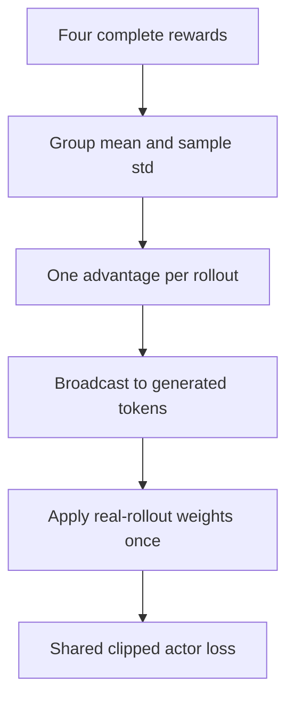

# 4. GRPO step by step

**Opening question: How can four attempts teach an actor without a critic?**

GRPO compares an attempt with other attempts at the same question. An above-average reward produces positive advantage; a below-average reward produces negative advantage. The update favors sampled actions with positive coefficients and disfavors those with negative coefficients, subject to the surrogate and shared model parameters.

For our **synthetic** `(7+5)*3` question, suppose four complete attempts earn `[0,0,0,1]`. The fourth might be Chapter 2's successful transcript. These are illustrative rewards, not r03 measurements.

## Compute the group-relative advantage

Let $q$ identify the question group and $\mathcal G_q$ its four real rollouts. $R_\rho$ is the terminal binary reward for rollout $\rho$.

$$
\bar R_q=\frac14\sum_{\rho\in\mathcal G_q}R_\rho=0.25.
$$

The implementation uses the sample standard deviation with Bessel correction, computed using `torch.std(unbiased=True)`. Under the usual independent, identically distributed sampling assumptions, Bessel correction makes the sample **variance** unbiased; its square root is not generally an unbiased estimator of standard deviation:

$$
s_q=\sqrt{\frac{\sum_{\rho\in\mathcal G_q}(R_\rho-\bar R_q)^2}{4-1}}
=\sqrt{\frac{3(0.25)^2+(0.75)^2}{3}}=0.5.
$$

Then $A_\rho=(R_\rho-\bar R_q)/(s_q+10^{-6})$.

| Synthetic rollout | Reward | Centered reward | Approximate advantage |
|---|---:|---:|---:|
| A | 0 | -0.25 | -0.5 |
| B | 0 | -0.25 | -0.5 |
| C | 0 | -0.25 | -0.5 |
| D | 1 | +0.75 | +1.5 |

The epsilon makes the final column approximate. Every generated action in a rollout receives its rollout's advantage before weighting. Fragments never contribute extra rewards to the group statistics.



Both `[0,0,0,0]` and `[1,1,1,1]` yield zero group-relative advantage. An all-success group can be useful behavior while supplying no current relative learning signal. Matched-v2 retains constant groups without replacement sampling.

## From advantage to a differentiable loss

Let $a$ be a sampled token and $h$ its exact preceding history. The policy $\pi_\theta(a\mid h)$ gives its probability under actor parameters $\theta$. Define probability ratio $u$ against saved pre-update log probabilities:

$$
d=\operatorname{clip}(\log\pi_\theta(a\mid h)-\log\pi_{\mathrm{old}}(a\mid h),-20,20),\qquad u=e^d.
$$

We use $u$ for the ratio so $\rho$ always means rollout. For an unweighted advantage $A$, the shared actor surrogate is

$$
\ell^+=\max\{-Au,-A\operatorname{clip}(u,0.8,1.3)\},
\qquad
\ell=\begin{cases}\min(\ell^+,-3A),&A<0,\\\ell^+,&A\geq0.\end{cases}
$$

The maximum is the loss-minimization form of PPO clipping. The negative-advantage branch is the configured dual clip. Both arms use this machinery. The matched loss is $\mathcal L_{\mathrm{actor}}=\sum_{\rho,j,t}w_{\rho,j,t}\ell_{\rho,j,t}$, with Chapter 3's weights. The runtime scales advantages once before the native masked-sum loss. Positive scaling commutes with these min/max operations.

## A synthetic clipping calculation

These three **synthetic** token examples use the configured bounds 0.8 and 1.3 and dual-clip parameter 3. They are unweighted loss contributions $\ell$; multiply by the token's rollout weight once to obtain $w\ell$.

| Case | $A$ | $u$ | Direct $-Au$ | Clipped-ratio term | $\ell^+$ (maximum) | Dual cap $-3A$ | Final $\ell$ |
|---|---:|---:|---:|---:|---:|---:|---:|
| Positive, above upper bound | 1 | 1.6 | -1.6 | -1.3 | -1.3 | Not used | -1.3 |
| Negative, below lower bound | -1 | 0.5 | 0.5 | 0.8 | 0.8 | 3 | 0.8 |
| Negative, dual cap active | -1 | 4 | 4 | 1.3 | 4 | 3 | 3 |

For the positive advantage, clipping stops further loss reduction from raising the ratio beyond 1.3. For the negative advantage below 0.8, it stops further loss reduction from lowering the ratio. In the third case, the negative-advantage dual cap limits the otherwise large loss to 3. These are properties of the surrogate, not a hard constraint on the updated policy.

```bash
python3 - <<'PY'
for advantage, ratio in [(1, 1.6), (-1, 0.5), (-1, 4.0)]:
    direct = -advantage * ratio
    clipped = -advantage * min(max(ratio, 0.8), 1.3)
    upper = max(direct, clipped)
    loss = min(upper, -3 * advantage) if advantage < 0 else upper
    print(tuple(round(x, 6) for x in (direct, clipped, upper, loss)))
PY
```

**Answer key:** `(-1.6, -1.3, -1.3, -1.3)`, `(0.5, 0.8, 0.8, 0.8)` and `(4.0, 1.3, 4.0, 3)`. The recorded one-update-per-collection experiment had zero measured actor clipping fractions and did not establish benefits from active repeated-epoch clipping. This table adds no experimental outcomes.

## Why near-zero loss can still yield a gradient

At the pre-update point, $u=1$. GRPO advantages sum to zero within each group. Each rollout has total weight $1/N$, so scalar contributions cancel up to floating-point error. Their derivatives need not cancel: different tokens and histories have different log-probability gradients.

For a **separate synthetic two-action example**, let $p=\sigma(\theta)=1/(1+e^{-\theta})$ be a sigmoid probability, old probability $p_0=1/2$, and advantages +1 and -1. In the unclipped neighborhood,

$$
\mathcal L(\theta)=-\tfrac12\left[\frac{p}{1/2}(1)+\frac{1-p}{1/2}(-1)\right]=1-2\sigma(\theta).
$$

At $\theta=0$, loss is 0 but its derivative is $-1/2$. Do not replace the ratio by a constant 1 before differentiating. An all-constant-reward batch differs: its advantages themselves are zero, so its current GRPO policy-gradient contribution is zero.

## Source, evidence and limits

The GRPO branch of [`matched_runtime.advantages`](https://github.com/amulyaparthasarathy/agent-lightning-lab-public/blob/89fe32f92f29209803c13264baed951713741d42/experiment/matched_runtime.py#L117) computes real-rollout statistics. [`normalize`](https://github.com/amulyaparthasarathy/agent-lightning-lab-public/blob/89fe32f92f29209803c13264baed951713741d42/experiment/matched_runtime.py#L113) supplies weights; [`compute_policy_loss_per_rollout_mean`](https://github.com/microsoft/agent-lightning/blob/cbc56e41e0eab643aa71d195e92e5bba652fa683/agentlightning/verl/per_rollout_loss.py#L46) supplies clipping and masked summation. [`ppo_contract.overrides`](https://github.com/amulyaparthasarathy/agent-lightning-lab-public/blob/89fe32f92f29209803c13264baed951713741d42/experiment/ppo_contract.py#L69) sets clip bounds. The lab's [`policy_loss`](https://github.com/amulyaparthasarathy/agent-lightning-lab-public/blob/89fe32f92f29209803c13264baed951713741d42/experiment/matched_runtime.py#L185) provides weighted diagnostics. [DeepSeekMath](https://arxiv.org/abs/2402.03300v3) is the GRPO method reference; exact conventions here come from code.

The [scientific analysis](../../evidence/phase2-r03/SCIENTIFIC_ANALYSIS.md) records eight GRPO steps with eight constant-reward groups, zero current gradients and actual optimizer calls. Near-zero scalar losses often coexist with nonzero gradients on other steps. Neither observation proves a parameter change after every call or which action caused success.

## Offline exercise and answer

This standard-library snippet checks the group calculation and separate derivative example:

```bash
python3 - <<'PY'
import math
from statistics import mean, stdev
rewards = [0, 0, 0, 1]
adv = [(r - mean(rewards)) / (stdev(rewards) + 1e-6) for r in rewards]
loss = lambda x: 1 - 2 / (1 + math.exp(-x))
h = 1e-5
print(mean(rewards), stdev(rewards), [round(a, 6) for a in adv])
print(round(loss(0), 6), round((loss(h) - loss(-h)) / (2*h), 6))
PY
```

**Answer:** Mean `0.25`, standard deviation `0.5`, advantages `[-0.499999, -0.499999, -0.499999, 1.499997]`; synthetic loss `0.0` and derivative `-0.5`. An all-equal reward vector has zero advantages. This arithmetic does not run the backend.

Next: [PPO-MC step by step](05-ppo-mc-step-by-step.md).
