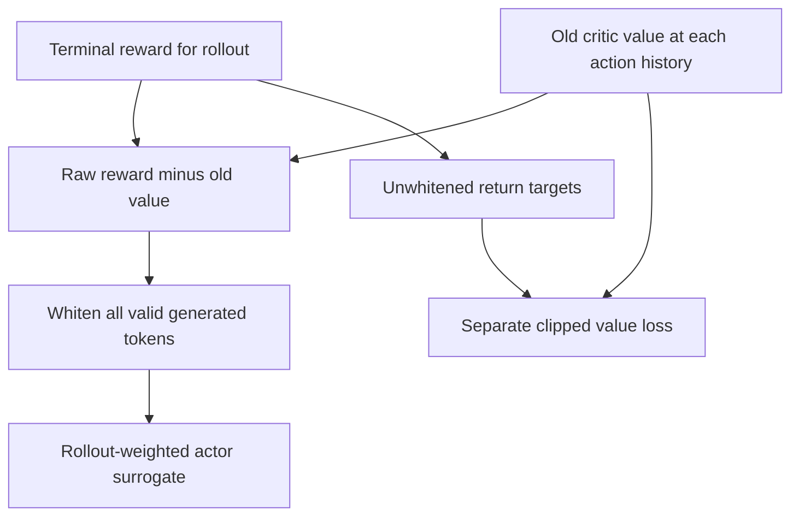

# 5. PPO-MC step by step

**Opening question: What changes when a learned prediction supplies the baseline?**

GRPO asks how an attempt compares with its peers. PPO-MC asks how the actual outcome compares with the critic's prediction at a particular history. The actor still uses the clipped surrogate from Chapter 4. The new pieces are a separate value model, token-level residuals, token whitening and a critic optimizer call.

## Reuse the synthetic calculator attempts

For our **synthetic** `(7+5)*3` task, keep rewards `[0,0,0,1]`. At one representative **later** action position in each rollout, suppose values are `[0.1,0.2,0.6,0.4]`. These histories may differ because the attempts have diverged. They are not measured predictions, and they are not four different values asserted for the same identical initial history.

| Rollout | Reward $R_\rho$ | Illustrative old value $V_{\mathrm{old}}$ | Raw residual $R_\rho-V_{\mathrm{old}}$ |
|---|---:|---:|---:|
| A | 0 | 0.1 | -0.1 |
| B | 0 | 0.2 | -0.2 |
| C | 0 | 0.6 | -0.6 |
| D | 1 | 0.4 | +0.6 |

The critic expected more from C than from A, so C has a more negative residual. That distinction helps only if the predictions are useful. A critic is a learned predictor of the scorer's return, not an independent verifier of arithmetic correctness. Its linear output is not constrained to the interval [0,1].



## Derive the terminal Monte Carlo target from general GAE

For this derivation, $t=1,\ldots,T$ enumerates generated actions in a complete rollout; observations enter the histories but are not additional actions. Let $r_t$ be reward after action $t$, $h_t$ the history before it, $V_t=V_{\mathrm{old}}(h_t)$ the pre-update value, $\gamma$ the discount and $\lambda$ the GAE mixing parameter. For terminal bootstrap $V_{T+1}=0$, the return is

$$
G_t=\sum_{k=t}^{T}\gamma^{k-t}r_k.
$$

A one-step temporal-difference residual is $\delta_t=r_t+\gamma V_{t+1}-V_t$. Generalized advantage estimation combines these residuals:

$$
\widehat A_t^{\mathrm{GAE}}=\sum_{l=0}^{T-t}(\gamma\lambda)^l\delta_{t+l}.
$$

At $\gamma=\lambda=1$, expand the sum:

$$
\widehat A_t=\sum_{k=t}^{T}r_k+(V_{t+1}-V_t)+(V_{t+2}-V_{t+1})+\cdots+(V_{T+1}-V_T).
$$

The intermediate values cancel. With zero terminal bootstrap and terminal-only reward $r_T=R_\rho$, this gives

$$
\widehat A_t=R_\rho-V_t,\qquad \widehat G_t=\widehat A_t+V_t=R_\rho.
$$

This is the Monte Carlo specialization. The matched configuration says `adv_estimator=gae`, `gamma=1`, `lam=1`, but **the executed override directly computes `targets - values`**, then whitens it. It does not call the generic GAE recurrence to build those residuals.

A nonterminal truncation can need a nonzero bootstrap, so the derivation cannot simply drop that term. Matched collection rejects missing/truncated token data. The harness's configured stopping horizon is a separate issue: its scored endpoint defines this bounded task. Copying its outcome onto fragments does not mean adding the same reward repeatedly along a stitched trajectory.

## Whitening and rollout weighting are different operations

Let $\mathcal M$ be **all valid generated-token positions in the complete collection**, and $M=|\mathcal M|$. For raw residual $a_i=R_{\rho(i)}-V_i$,

$$
\mu_a=\frac1M\sum_{i\in\mathcal M}a_i,\qquad
s_a^2=\frac1{M-1}\sum_{i\in\mathcal M}(a_i-\mu_a)^2,\qquad
\widetilde A_i=\frac{a_i-\mu_a}{\sqrt{s_a^2+10^{-8}}}.
$$

The runtime requires at least two valid tokens and uses unbiased sample variance. Observation/padding positions are excluded and masked out. **The four table entries are not the whitening population of a real collection.** Whitening only them is a small arithmetic illustration; real execution includes every valid generated token across all 32 rollouts.

After whitening, Chapter 3's $w_{\rho,j,t}=m_{\rho,j,t}/(N L_\rho)$ scales the actor contribution. Whitening treats valid tokens uniformly; loss weighting gives complete rollouts equal total weight. Return targets remain $R_\rho$ and are never whitened. Even when all rewards are zero, differing values can produce nonzero whitened advantages. This proves a mechanism, not useful learning.

## A fully specified synthetic collection

To finish the arithmetic, define a separate **synthetic toy collection**, motivated by the same calculator task. It has **$N=4$ complete toy rollouts** A–D with rewards `[0,0,0,1]`, one fragment each, and generated-token counts $L_A=2$, $L_B=1$, $L_C=1$, $L_D=2$. The table below specifies every position used in this toy. It is an arithmetic fixture, not a possible full tokenization of the calculator transcript or a study batch. Here $M=6$ valid generated positions; the actual study uses $N=32$ and many more tokens.

The old values are assigned to distinct synthetic histories. They do not assert different predictions for identical histories. The masked observation's deliberately irrelevant value 9 shows that it contributes neither to whitening statistics nor to either loss. Its raw residual is shown before masking.

| Rollout | Position | Kind | $R_\rho$ | Old $V_i$ | Mask $m_i$ | Raw $R_\rho-V_i$ |
|---|---|---|---:|---:|---:|---:|
| A | 1 | Generated | 0 | 0.1 | 1 | -0.1 |
| A | 2 | Observation | 0 | 9.0 | 0 | -9.0 (excluded) |
| A | 3 | Generated | 0 | 0.3 | 1 | -0.3 |
| B | 1 | Generated | 0 | 0.2 | 1 | -0.2 |
| C | 1 | Generated | 0 | 0.6 | 1 | -0.6 |
| D | 1 | Generated | 1 | 0.4 | 1 | +0.6 |
| D | 2 | Generated | 1 | 0.8 | 1 | +0.2 |

Over the six valid residuals, the sum is $-0.4$, so $\mu_a=-0.4/6=-1/15$. The sum of squared deviations is $0.873333\ldots$, giving sample variance

$$
s_a^2=\frac{0.873333\ldots}{6-1}=\frac{131}{750}=0.174666\ldots,
\qquad \sqrt{s_a^2+10^{-8}}\approx0.417931426.
$$

Subtract this mean and divide by that square root, then apply the **separate** weights $w_i=m_i/(4L_{\rho(i)})$. For an illustrative actor ratio $u=1$, clipping is inactive and each token's loss contribution is $-w_i\widetilde A_i$:

| Position | Whitened $\widetilde A_i$ | $w_i$ | Actor coefficient $w_i\widetilde A_i$ | Loss at $u=1$ |
|---|---:|---:|---:|---:|
| A:1 | -0.079758 | 1/8 | -0.009970 | +0.009970 |
| A:2, masked | 0 | 0 | 0 | 0 |
| A:3 | -0.558305 | 1/8 | -0.069788 | +0.069788 |
| B:1 | -0.319032 | 1/4 | -0.079758 | +0.079758 |
| C:1 | -1.276126 | 1/4 | -0.319032 | +0.319032 |
| D:1 | +1.595158 | 1/8 | +0.199395 | -0.199395 |
| D:2 | +0.638063 | 1/8 | +0.079758 | -0.079758 |

Numbers are rounded for display. Each rollout's weights sum to $1/4$, although A and D each supply twice as many valid tokens to whitening as B or C. The weighted actor coefficients need not sum to zero: token centering and equal-rollout reduction use different populations. Apply the weight **once**, either to the advantage before the native surrogate or to the resulting unweighted surrogate, not both.

## What is the critic, and how does it train?

The critic has a **separate Llama backbone**, loaded from the same prepared base directory, and a token-classification head. It does not share the actor's live backbone. The constructor must yield `LlamaForTokenClassification`. Only `score.weight` and `score.bias` may be newly missing; the unused `lm_head.weight` is allowed. Other loading mismatches fail rather than silently selecting another model.

The new head weight uses Transformers' normal initialization with `initializer_range`; the bias starts at zero. Matched initialization uses the job's dedicated critic seed inside a forked Torch RNG context. This replaces the legacy smoke's fixed seed and avoids advancing actor/data RNG state through critic construction. The critic learns its backbone and head, not just the head.

For updated prediction $v_i=V_\phi(h_i)$, cached old value $V_i$ and target $R_{\rho(i)}$, define

$$
v_i^{\mathrm{clip}}=V_i+\operatorname{clip}(v_i-V_i,-0.5,0.5),
$$

$$
\mathcal L_V=\frac12\sum_i w_i\max\{(v_i-R_{\rho(i)})^2,(v_i^{\mathrm{clip}}-R_{\rho(i)})^2\}.
$$

This is the matched single-GPU value objective. The source also includes data-parallel scaling for its backend contract. Actor and critic have separate loss reductions and optimizers; the critic target does not inherit the actor's weighted advantage.

### One synthetic clipped-value-loss contribution

Continue with toy position **C:1**: old value $V_i=0.6$, candidate value $v_i=0$, unwhitened return target $R_C=0$, and weight $w_i=1/4$. The candidate change is $-0.6$, clipped to $-0.5$, so $v_i^{\mathrm{clip}}=0.6-0.5=0.1$. The candidate squared error is $(0-0)^2=0$; the clipped squared error is $(0.1-0)^2=0.01$. The maximum selects 0.01, so this token contributes

$$
\frac12\times\frac14\times\max(0,0.01)=0.00125.
$$

This limits the apparent improvement in the clipped objective; it does not prohibit the candidate value itself. This is one token's contribution, not the full critic loss.

The following standard-library calculation checks the entire toy collection and this value-loss case. It uses the implementation's `sqrt(sample_variance + 1e-8)` convention. Return targets stay unwhitened.

```bash
python3 - <<'PY'
from math import isclose, sqrt
from statistics import mean, variance
# rollout, position, terminal reward, old value, generated-token mask
rows = [("A", 1, 0, .1, 1), ("A", 2, 0, 9., 0),
        ("A", 3, 0, .3, 1), ("B", 1, 0, .2, 1),
        ("C", 1, 0, .6, 1), ("D", 1, 1, .4, 1),
        ("D", 2, 1, .8, 1)]
lengths = {rid: sum(m for r, _, _, _, m in rows if r == rid)
           for rid in {r[0] for r in rows}}
N = len(lengths)
valid = [reward - old for _, _, reward, old, mask in rows if mask]
mu, var = mean(valid), variance(valid)
assert N == 4 and len(valid) == 6
assert isclose(mu, -1/15) and isclose(var, 131/750)
print("mean, sample variance:", round(mu, 9), round(var, 9))
totals = dict.fromkeys(lengths, 0.)
for rid, pos, reward, old, mask in rows:
    z = (reward - old - mu) / sqrt(var + 1e-8) if mask else 0.
    w = mask / (N * lengths[rid])
    totals[rid] += w
    print(f"{rid}:{pos}", *(round(x, 6) for x in (z, w, w*z, -w*z)))
assert all(isclose(total, 1/N) for total in totals.values())
old, candidate, target, weight = .6, 0., 0., 1/4
clipped = old + min(max(candidate - old, -.5), .5)
errors = (candidate - target)**2, (clipped - target)**2
contribution = .5 * weight * max(errors)
assert isclose(clipped, .1) and isclose(contribution, .00125)
print("clipped, errors, maximum, half, weight, contribution:",
      *(round(x, 6) for x in (clipped, *errors, max(errors), .5,
                              weight, contribution)))
PY
```

**Answer key:** Mean `-0.066666667`, sample variance `0.174666667`; each printed row matches the preceding whitening/weight table. The last line is `0.1 0.0 0.01 0.01 0.5 0.25 0.00125`. These toy results do not extend the recorded experiment's evidence.

## Source, predictive evidence and historical limits

Read [`matched_runtime.advantages`](https://github.com/amulyaparthasarathy/agent-lightning-grpo-ppo/blob/89fe32f92f29209803c13264baed951713741d42/experiment/matched_runtime.py#L117), [`value_loss`](https://github.com/amulyaparthasarathy/agent-lightning-grpo-ppo/blob/89fe32f92f29209803c13264baed951713741d42/experiment/matched_runtime.py#L167), [`ppo_runtime._instrument_engine`](https://github.com/amulyaparthasarathy/agent-lightning-grpo-ppo/blob/89fe32f92f29209803c13264baed951713741d42/experiment/ppo_runtime.py#L379), and [`ppo_contract.overrides`](https://github.com/amulyaparthasarathy/agent-lightning-grpo-ppo/blob/89fe32f92f29209803c13264baed951713741d42/experiment/ppo_contract.py#L69). The [pinned generic GAE](https://github.com/verl-project/verl/blob/7aed6b230776f963fa09509c10d9c3a767d1102c/verl/trainer/ppo/core_algos.py#L216) skips observation gaps. [GAE's paper](https://arxiv.org/abs/1506.02438v6) supplies method attribution; the direct matched override defines this execution.

[`prediction_metrics`](https://github.com/amulyaparthasarathy/agent-lightning-grpo-ppo/blob/89fe32f92f29209803c13264baed951713741d42/experiment/ppo_math.py#L101) reports pre-update valid-token MSE, mean squared prediction error, and explained variance. Qualified EV uses $1-\operatorname{Var}(V-R)/(\operatorname{Var}(R)+10^{-5})$ only when target sample variance exceeds $10^{-8}$. Constant targets make qualified EV undefined. This token-population diagnostic differs from the clipped, half-scaled, rollout-weighted training loss.

The [scientific analysis](../../evidence/phase2-r03/SCIENTIFIC_ANALYSIS.md) reports decreasing critic MSE, but no win over the recorded earlier-data constant predictor in 57 comparable steps; all 51 defined EV observations were negative. There is no earlier-data predictor comparison at the first step. The predictor is the mean of earlier rollout rewards, evaluated on current valid tokens. These findings do not establish that the critic caused either arm's endpoint performance.

The [2026-11-14 PPO smoke contract](../PHASE2_PPO_PROTOCOL.md) preserves legacy row retention/reductions and generic GAE plumbing. Its pre-execution language describes that review date. Final matched-v2 retains complete collections, directly constructs residuals, and supplies separate rollout-weighted actor/critic reductions. Standalone `ppo_math` ports are not automatically identical to this final runtime.

## Offline exercise and answer

Check raw residuals and a separate three-action GAE telescoping example:

```bash
python3 - <<'PY'
rewards, values = [0, 0, 0, 1], [0.1, 0.2, 0.6, 0.4]
print([round(r-v, 6) for r, v in zip(rewards, values)])
r, v = [0, 0, 1], [0.1, 0.2, 0.4]
next_value = advantage = 0.0
raw = []
for reward, value in reversed(list(zip(r, v))):
    delta = reward + next_value - value
    advantage = delta + advantage
    raw.append(advantage)
    next_value = value
print([round(x, 6) for x in reversed(raw)])
PY
```

**Answer:** `[-0.1, -0.2, -0.6, 0.6]` and `[0.9, 0.8, 0.6]`. In the second example each value plus raw advantage equals terminal return 1. These are synthetic calculations, before full-collection whitening and rollout weighting.

Next: [one complete training update](06-one-complete-training-update.md).
