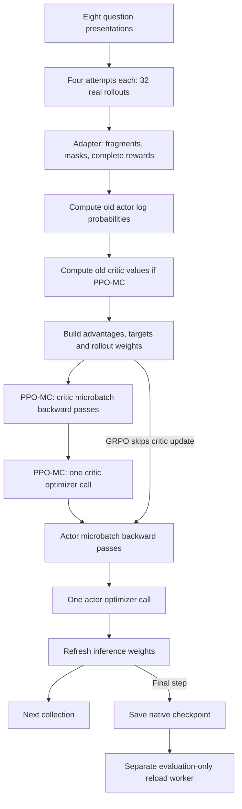

# 6. One complete training update

**Opening question: When do collected experiences actually reach an optimizer?**

A collection is the set of experiences used together for one update. A microbatch is a way to fit its computation in memory. Splitting that computation into pieces does not require changing parameters after each piece.

Imagine our **synthetic** `(7+5)*3` group is one of eight question presentations. Its four attempts join 28 attempts from seven other presentations. This gives **32 real rollouts**, possibly represented by more than 32 fragment rows. This illustration explains the r03 protocol; it is not a reconstructed recorded collection.

## Collection to actor and critic updates

The diagram is a logical sequence. Checkpoint save timing is handled by the trainer's step loop; it is not a new save after every iteration in r03.

1. **Collect and validate.** The gateway/controller run the harnesses; the adapter builds rows. The matched wrapper rejects missing rewards, incomplete groups, lost generated tokens or invalid contexts. Constant-reward groups remain.
2. **Cache pre-update predictions.** The trainer recomputes old actor log probabilities and, for PPO-MC, values. It constructs returns and advantages before either role updates.
3. **Prepare loss weights.** GRPO broadcasts group-relative advantages. PPO-MC whitens all valid raw token residuals. The actor receives advantages multiplied by $w_{\rho,j,t}=m_{\rho,j,t}/(32L_\rho)$ once. The critic receives terminal targets plus its own weight tensor.
4. **Update the critic if present.** Forward/backward microbatches contribute gradients of the clipped value loss. After accumulation, the critic optimizer runs once. Cached advantages and old values are not recomputed from this newly updated critic for the current actor update.
5. **Update the actor.** The same collection's actor microbatches compute the shared clipped surrogate and accumulate gradients. The actor optimizer runs once.
6. **Refresh serving weights.** The trainer sends updated actor parameters to the inference runtime before the next collection.

In this recipe there is one PPO epoch, a full-collection minibatch, and static microbatches of one row. [`patch_update`](https://github.com/amulyaparthasarathy/agent-lightning-lab-public/blob/main/experiment/matched_runtime.py#L96) sets the update minibatch size to `len(batch)`. [`patch_train_step`](https://github.com/amulyaparthasarathy/agent-lightning-lab-public/blob/main/experiment/matched_runtime.py#L83) removes legacy row flooring/dropping. The number of fragments does not redefine $N$ or create more optimizer calls.

## What a backward pass contributes

For microbatch $b$ containing some generated-token loss terms,

$$
g_b=\nabla_\theta\sum_{i\in b}w_i\ell_i,\qquad
 g=\sum_b g_b.
$$

Here $\theta$ denotes the actor parameters, $w_i$ the rollout weights and $\ell_i$ Chapter 4's surrogate. The pinned FSDP path calls `backward()` for each microbatch without another accumulation divisor. Applying an extra division by fragment count would change the objective. After accumulation the engine clips the gradient norm and invokes AdamW when gradients are finite. Its update depends on optimizer state as well as the current gradient.

The shared actor learning rate is `1e-6`; the PPO critic's is `1e-5`. Both use one epoch and gradient-norm clipping at 1; value clipping has radius 0.5. These are execution settings, not recommended tuning choices for other tasks.

## Three different claims about an update

| Observation | What it establishes |
|---|---|
| Nonzero current gradient | The current differentiable objective supplies a direction at this point |
| Optimizer post-hook fired | The actual optimizer's step method ran |
| Measured parameter delta | Particular stored weights changed by a measured amount |

The runtime's [`_instrument_engine`](https://github.com/amulyaparthasarathy/agent-lightning-lab-public/blob/main/experiment/ppo_runtime.py#L379) registers an optimizer step post-hook and records gradient diagnostics. A logged training row alone would not prove a call. Conversely, an actual call with zero current gradients can still move parameters through AdamW state or decay. Per-parameter deltas were not measured, so the guide does not claim every call changed weights.

## Old, current, inference and reference policy

| Name | Meaning here |
|---|---|
| Current actor | Parameters used for the differentiable training forward pass |
| Old actor | Pre-update log probabilities cached for the current collection's ratios |
| Inference policy | The vLLM copy used to sample actions, refreshed explicitly |
| Reference policy | A potential fixed comparison model for a KL penalty; no active penalty here |

All microbatches run before the single actor optimizer call. The recorded actor clipping fractions and pre-update `actor/ppo_kl` are zero in this configuration. That does not measure post-update drift. Repeated-epoch clipping benefits were not tested. `rollout_corr/kl` and `rollout_corr/k3_kl` instead describe inference-versus-recomputed-old log-probability mismatch. They are not reference-policy KL. Entropy calculation is disabled, so missing entropy is not measured zero entropy.

## Save, reload and evaluate

After the final update, each study run saves one native `global_step_20` checkpoint. It includes actor model, optimizer and extra state; PPO includes critic state too. Native training checkpoints are not automatically deployable Hugging Face exports.

[`checkpoint_identity` and `verify_checkpoint`](https://github.com/amulyaparthasarathy/agent-lightning-lab-public/blob/main/experiment/matched_launch.py#L158) inventory role files, bind the plan/configuration/algorithm and check final-step identity. [`configuration`](https://github.com/amulyaparthasarathy/agent-lightning-lab-public/blob/main/experiment/matched_launch.py#L49) selects `resume_path` and validation-only behavior for `checkpoint-eval`. [`complete_stage`](https://github.com/amulyaparthasarathy/agent-lightning-lab-public/blob/main/experiment/matched_launch.py#L183) requires the expected refresh, no optimizer calls and complete evaluation, then verifies checkpoint identity again.

This final evaluation runs in a **separate worker**, not as another training update. It reloads the checkpoint and refreshes inference weights from it. The [stage receipts](../../evidence/phase2-r03/stage_receipts.csv) retain worker and checkpoint identities. All six final evaluations had zero optimizer updates.

## Pinned implementation and evidence limits

Follow [`AgentLightningRayPPOTrainer._train_step`](https://github.com/microsoft/agent-lightning/blob/cbc56e41e0eab643aa71d195e92e5bba652fa683/agentlightning/verl/trainer.py#L463), [`TrainingWorker.train_mini_batch` and `train_batch`](https://github.com/verl-project/verl/blob/7aed6b230776f963fa09509c10d9c3a767d1102c/verl/workers/engine_workers.py#L234), and [`FSDPEngine.forward_backward_batch` and `optimizer_step`](https://github.com/verl-project/verl/blob/7aed6b230776f963fa09509c10d9c3a767d1102c/verl/workers/engine/fsdp/transformer_impl.py#L617). Loss dispatch begins in [`ppo_loss`](https://github.com/verl-project/verl/blob/7aed6b230776f963fa09509c10d9c3a767d1102c/verl/workers/utils/losses.py#L57). The lab's [`register_in_worker`](https://github.com/amulyaparthasarathy/agent-lightning-lab-public/blob/main/experiment/matched_runtime.py#L263) installs overrides and refresh/save instrumentation. [`matched_app.stage_worker` and `supervise`](https://github.com/amulyaparthasarathy/agent-lightning-lab-public/blob/main/matched_app.py#L58) govern separate worker stages.

The [verification ledger](../../evidence/phase2-r03/VERIFICATION.md) records training refreshes 0 through 20, actual actor counts 1 through 20, and the same critic count sequence for PPO. It verifies recorded checkpoint inventories and reload evidence. This guide does not independently download or load the remote tensors. Source equality and paired seeds do not guarantee bitwise determinism under serving schedules and GPU execution.

## Offline exercise and answer

**Exercise:** Suppose one complete synthetic collection has 32 rollouts and 70 valid fragment rows. Under this configuration, how many actor backward microbatches and optimizer calls does it contain? What changes for PPO-MC? Does the final reload add an update?

**Answer:** With microbatch size one row, 70 actor backward microbatches accumulate into **one actor optimizer call**. PPO-MC also has 70 critic backward microbatches and **one critic call** before the actor update. It retains the same 32-rollout loss denominator. The evaluation-only reload adds zero optimizer calls. The 70 rows are illustrative, not a recorded r03 count.

Next: [read the experiment results](07-read-the-experiment-results.md).
