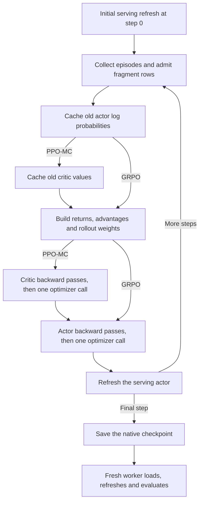

# 6. One complete training update

D requested `(7+5)*3`, saw the calculator return `36`, wrote the correct answer and earned 1. At the end of [Chapter 5](05-ppo-mc-step-by-step.md), we could compute a loss for that experience. **When can the next attempt actually sample from an updated actor?** Follow D from collection to the optimizer, then from the optimizer to the copy that serves the next request.

## From a scored episode to a training row

A **collection** is the set of episodes used together for an update. Start a training run from the base actor. The trainer first refreshes the inference policy at step 0. In the calculator study, each training step presents eight questions and samples four attempts per question. Picture A, B, C and D as one such group, alongside 28 attempts on the other seven questions. The numbers of groups and attempts come from the study configuration. Our particular questions, tokens, rewards and fragment counts are synthetic. [Matched configuration](https://github.com/amulyaparthasarathy/agent-lightning-grpo-ppo/blob/89fe32f92f29209803c13264baed951713741d42/experiment/matched_launch.py#L49)

The harness executes tool requests, captures model calls and posts a terminal reward for each episode. The adapter builds rows from completed attempts. The matched wrapper checks for distinct rollout IDs, four attempts in each group, binary rewards, valid prompt context and agreement between captured and retained generated-token counts. Losing one of D's four generated targets would reject the collection. Four failures on the same question are valid outcomes and stay in the batch. [Matched admission and row retention](https://github.com/amulyaparthasarathy/agent-lightning-grpo-ppo/blob/89fe32f92f29209803c13264baed951713741d42/experiment/matched_runtime.py#L209) · [Trainer overlay](https://github.com/amulyaparthasarathy/agent-lightning-grpo-ppo/blob/89fe32f92f29209803c13264baed951713741d42/experiment/matched_runtime.py#L83)

Recall [D's two prompt histories](03-trajectories-tokens-and-fragments.md). When the second prompt extends the first call exactly, one response row holds `[20, 21, 30, 40, 41]` with mask `[1, 1, 0, 1, 1]`. When the harness supplies a different prefix, the adapter preserves the history of each call in a separate row. In either case, D has one rollout ID, four generated targets and one terminal score. The observation at `30` supplies context for predicting `40`. It carries zero direct loss weight.

## The order of one iteration

Read down the PPO-MC path first. GRPO follows the same collection, actor and serving path and skips the critic.



### Freeze the information that describes this collection

At D's history ending in `30`, the sampler has already recorded a log probability for target `40` in `rollout_log_probs`. The trainer runs the pre-update actor on the captured history and stores the result in `old_log_probs`. This recomputed number is the fixed denominator, in log form, for the [actor probability ratio](04-grpo-step-by-step.md#from-advantage-to-a-differentiable-loss). The differentiable actor forward pass later supplies the numerator. In PPO-MC the trainer also caches the old critic's value at this position before computing advantages. [Pinned prediction passes](https://github.com/microsoft/agent-lightning/blob/cbc56e41e0eab643aa71d195e92e5bba652fa683/agentlightning/verl/trainer.py#L583)

The matched override looks up each real rollout's terminal score and fills the return tensor at its generated targets. For GRPO it broadcasts the group-relative advantage computed from the four scores. For PPO-MC it subtracts each old value from the return and whitens the residuals across all valid generated tokens in this collection. At D's target `40`, the illustrative old value of 0.4 gives return 1 and raw advantage +0.6. The whitened value now depends on the other 31 attempts as well. [Matched advantage calculation](https://github.com/amulyaparthasarathy/agent-lightning-grpo-ppo/blob/89fe32f92f29209803c13264baed951713741d42/experiment/matched_runtime.py#L117)

The trainer multiplies the actor advantages by the [Chapter 3 rollout weights](03-trajectories-tokens-and-fragments.md#equal-weight-for-each-real-rollout) once. D gets $1/32$ of the total weight. Each of its four generated tokens gets $1/(32\times4)=1/128$, across either arrangement of rows. The critic uses the unwhitened return and applies the stored rollout weights directly to its value errors. [Matched reductions](https://github.com/amulyaparthasarathy/agent-lightning-grpo-ppo/blob/89fe32f92f29209803c13264baed951713741d42/experiment/matched_runtime.py#L102)

### Fit the critic, then update the actor using the cached advantages

A **backward pass** computes how a loss changes with the model's parameters and accumulates that gradient. An **optimizer call** uses the accumulated gradient and optimizer state to update those parameters. Here the **minibatch** for one optimizer call is the entire retained collection. A **microbatch** is the piece processed in one forward/backward pass to fit it in memory. The matched patch sets the minibatch size to the actual row count, runs one epoch and uses static microbatches of one row on one GPU. [Full-collection patch](https://github.com/amulyaparthasarathy/agent-lightning-grpo-ppo/blob/89fe32f92f29209803c13264baed951713741d42/experiment/matched_runtime.py#L96) · [Worker minibatch iteration](https://github.com/verl-project/verl/blob/7aed6b230776f963fa09509c10d9c3a767d1102c/verl/workers/engine_workers.py#L234)

1. **Critic, PPO-MC only.** The engine clears the critic gradients. Each row contributes a backward pass for the clipped value loss against the cached old values and terminal returns. Once all rows have contributed, the engine clips the accumulated gradient norm and calls the critic optimizer if the norm is finite.
2. **Actor, both algorithms.** The engine clears the actor gradients. Each row contributes the gradient of the clipped surrogate with the cached old log probabilities and weighted advantages. After all rows, the engine clips the accumulated norm and calls the actor optimizer under the same finite-gradient condition.

Why does D keep the advantage computed from 0.4 even if the critic now predicts 0.7? The trainer has **already stored** the advantages in the batch. The critic call returns update metrics and changes the separate critic's parameters. The very next trainer operation passes that batch to the actor. There is no second value pass, subtraction or whitening. Substituting 0.7 would change the raw residual to +0.3 and mix an estimate fitted to this collection's outcome into the learning signal for the same collection. The updated critic supplies predictions when the trainer prepares the next collection. [Advantage storage and role update order](https://github.com/microsoft/agent-lightning/blob/cbc56e41e0eab643aa71d195e92e5bba652fa683/agentlightning/verl/trainer.py#L630)

For an actor microbatch $b$, write $w_i$ for position $i$'s weight, $\ell_i$ for its unweighted surrogate and $\theta$ for the actor parameters. The accumulated gradient is

$$
g=\sum_b g_b,\qquad g_b=\nabla_\theta\sum_{i\in b}w_i\ell_i.
$$

The weights already average within each episode and across the 32 episodes. Dividing again by the number of fragments would shrink the update whenever an episode split. The pinned engine sums the microbatch contributions. The matched recipe clips the gradient norm at 1 and uses AdamW with learning rates of `1e-5` for the critic and `1e-6` for the actor. The critic's separate value-clipping radius of 0.5 applies inside its loss, before backward. [Engine accumulation and step](https://github.com/verl-project/verl/blob/7aed6b230776f963fa09509c10d9c3a767d1102c/verl/workers/engine/fsdp/transformer_impl.py#L617) · [Optimizer settings](https://github.com/amulyaparthasarathy/agent-lightning-grpo-ppo/blob/89fe32f92f29209803c13264baed951713741d42/experiment/ppo_contract.py#L69)

### Make the new actor available to the next attempt

After the actor call, the trainer refreshes the vLLM inference copy from the training actor. This is the point at which the next collection can use the updated policy. A **refresh** transfers weights to the sampler. A **checkpoint save** writes state to persistent storage so another worker can load it later. At an ordinary r03 step the trainer refreshes and proceeds to the next collection. At the terminal study step it refreshes, returns from the step and saves in the outer training loop. [Refresh after the actor call](https://github.com/microsoft/agent-lightning/blob/cbc56e41e0eab643aa71d195e92e5bba652fa683/agentlightning/verl/trainer.py#L663) · [Outer save condition](https://github.com/microsoft/agent-lightning/blob/cbc56e41e0eab643aa71d195e92e5bba652fa683/agentlightning/verl/trainer.py#L731)

This timing also explains the diagnostics. All differentiable actor forwards in this recipe occur before its single optimizer call. Recorded actor clipping fractions and `actor/ppo_kl` were zero there. They compare the current training actor with the old probabilities within that update. The `rollout_corr/kl` and `rollout_corr/k3_kl` metrics compare sampling with old-probability recomputation. A fixed reference policy would answer a different question about drift from the base. The study had no active reference penalty and did not measure base-reference KL or entropy. [Recorded diagnostic definitions and results](../../evidence/phase2-r03/SCIENTIFIC_ANALYSIS.md#training-signal-and-critic-behavior)

## Count the work on a CPU

**Predict.** Suppose just D in the first group needs two rows. All other episodes fit in one. How many backward passes does each trained role need? How many times does its optimizer run?

Run the following from the repository root in a Unix shell with Python 3.12. This synthetic accounting exercise repeats the four response lengths from Chapters 4–5 in eight groups. It counts scheduled events without loading a model or performing optimization.

```bash
python3 - <<'PY'
from collections import Counter
from fractions import Fraction

split_d = True
rows = []
for group in range(8):
    for attempt, length in zip("ABCD", [2, 3, 2, 4], strict=True):
        episode = (group, attempt)
        parts = [2, 2] if split_d and episode == (0, "D") else [length]
        rows.extend((episode, n) for n in parts)

lengths = Counter()
for episode, n in rows:
    lengths[episode] += n
d = (0, "D")
d_weight = sum(Fraction(n, len(lengths) * lengths[d])
               for episode, n in rows if episode == d)
print("episodes, rows, generated targets:", len(lengths), len(rows), lengths.total())
print("D total loss weight:", d_weight)

# One epoch, one minibatch containing all rows, one row per microbatch.
for algorithm, roles in [("PPO-MC", ["critic", "actor"]), ("GRPO", ["actor"])]:
    events = []
    for role in roles:
        events.extend((role, "backward") for row in rows)
        events.append((role, "step"))
    for role in roles:
        print(algorithm, role, "backwards", events.count((role, "backward")),
              "optimizer calls", events.count((role, "step")))
PY
```

```text
episodes, rows, generated targets: 32 33 88
D total loss weight: 1/32
PPO-MC critic backwards 33 optimizer calls 1
PPO-MC actor backwards 33 optimizer calls 1
GRPO actor backwards 33 optimizer calls 1
```

**Optional alteration.** Set `split_d = False` to count the exact-prefix representation. The first line becomes `32 32 88` after the label. Each trained role now needs 32 backward passes. D's total weight stays at 1/32 and each role still has one full-collection optimizer call. This changes the storage accounting only. A real adapter must preserve the history actually seen at each call.

## Which events did the calculator study record?

| Event | One synthetic PPO-MC collection above | Recorded r03 PPO-MC study run, per seed |
|---|---|---|
| Training episodes | 32, represented by 33 rows | 20 collections × 32 = 640 episodes |
| Critic and actor work | 33 backwards, then one call for each role, critic first | 20 actual critic calls and 20 actual actor calls. Backward work depends on each collection's rows. |
| Serving refresh in training | One after the actor call | Step 0 before collection, then steps 1 through 20 (21 refreshes) |
| Native save | Only if this is the terminal step | One checkpoint at `global_step_20` |
| Independent checkpoint evaluation | Outside the collection | One refresh from step 20, 64 scored episodes, zero optimizer calls and zero new saves |

The three GRPO study runs also recorded 20 actor calls each, with no critic. How do we know the optimizer ran? The lab registered a **post-hook**, a callback that records when the actual optimizer step method has run. Eight GRPO calls had a zero current gradient after all groups in the collection earned constant rewards. AdamW's accumulated state and weight decay can still affect parameters. Establishing which stored weights moved, and by how much, would require measuring parameter differences. The study recorded calls and gradient diagnostics. [Optimizer instrumentation](https://github.com/amulyaparthasarathy/agent-lightning-grpo-ppo/blob/89fe32f92f29209803c13264baed951713741d42/experiment/ppo_runtime.py#L379) · [r03 verification ledger](../../evidence/phase2-r03/VERIFICATION.md)

### Check that the saved actor served the independent evaluation

The native checkpoint contains actor model, optimizer and extra-state files, plus the corresponding critic files for PPO-MC. The lab inventories the role files with sizes and hashes and binds the checkpoint to the job and final step. A **fresh worker** verifies the inventory, selects the checkpoint via `resume_path`, loads it and refreshes inference weights at the loaded step. With validation-only enabled, the trainer evaluates the frozen panel and returns before entering the training loop. The completion check verifies the checkpoint identity again and checks for a complete evaluation, zero optimizer calls and no new save. This qualifies evaluation reload. Resuming optimizer-state training or serving an exported model would require separate evidence. [Matched checkpoint and stage checks](https://github.com/amulyaparthasarathy/agent-lightning-grpo-ppo/blob/89fe32f92f29209803c13264baed951713741d42/experiment/matched_launch.py#L158) · [Pinned load, refresh and early return](https://github.com/microsoft/agent-lightning/blob/cbc56e41e0eab643aa71d195e92e5bba652fa683/agentlightning/verl/trainer.py#L680)

Read the committed [stage receipts](../../evidence/phase2-r03/stage_receipts.csv) for PPO-MC seed 2001. Predict what the reload row will report for the global step and the number of new optimizer calls.

```bash
python3 - <<'PY'
import csv

with open("evidence/phase2-r03/stage_receipts.csv", newline="") as f:
    stages = {r["stage"]: r for r in csv.DictReader(f)
              if r["phase"] == "exploratory" and r["algorithm"] == "ppo-mc-matched-v2"
              and r["seed"] == "2001"}
print("stage global_step episodes actor_calls critic_calls")
for stage in ["baseline", "training", "checkpoint-eval"]:
    r = stages[stage]
    print(stage, r["terminal_global_step"], r["case_count"],
          r["actor_updates"], r["critic_updates"])
train, reload = stages["training"], stages["checkpoint-eval"]
print("different worker calls:", train["worker_call_id"] != reload["worker_call_id"])
digest = train["checkpoint_sha256"]
print("same recorded checkpoint digest:", bool(digest) and digest == reload["checkpoint_sha256"])
PY
```

```text
stage global_step episodes actor_calls critic_calls
baseline 0 64 0 0
training 20 640 20 20
checkpoint-eval 20 64 0 0
different worker calls: True
same recorded checkpoint digest: True
```

The reload's `20` identifies the state it read. The two zeros count optimizer calls in that evaluation worker. This command compares published records without reopening checkpoint files. The reused 64-question development panel measures behavior on those questions. The separate recovery GRPO pilot P02 saved and reloaded **step 16** and evaluated 24 development cases. Those counts belong to the recovery task. [Recovery P02 closeout](../PHASE4C_FUNCTIONAL_PILOT_CLOSEOUT.md)

Continue to [Chapter 7 · Read the experiment results](07-read-the-experiment-results.md) to compare what the six calculator runs did on that panel.
