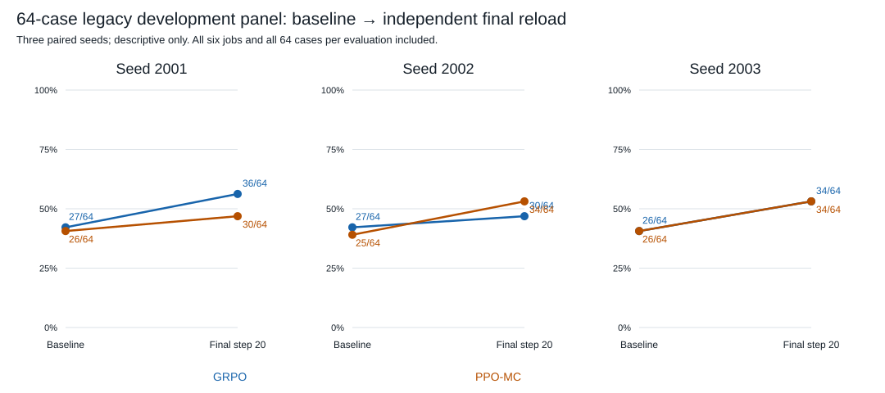
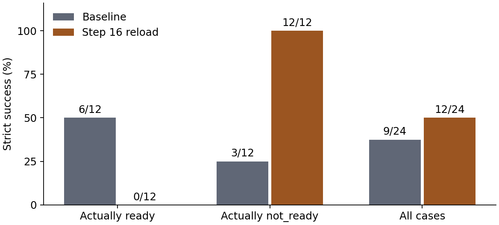
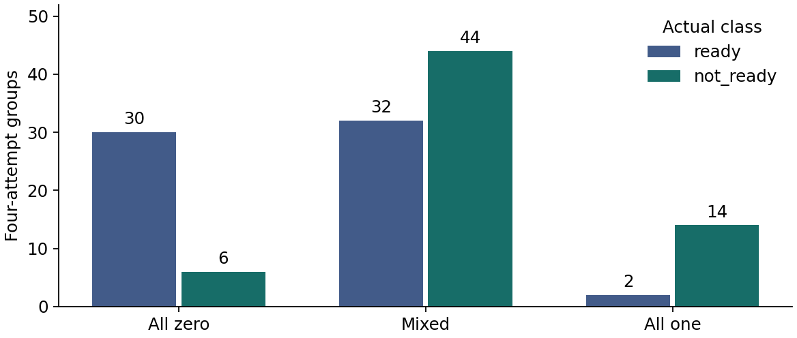
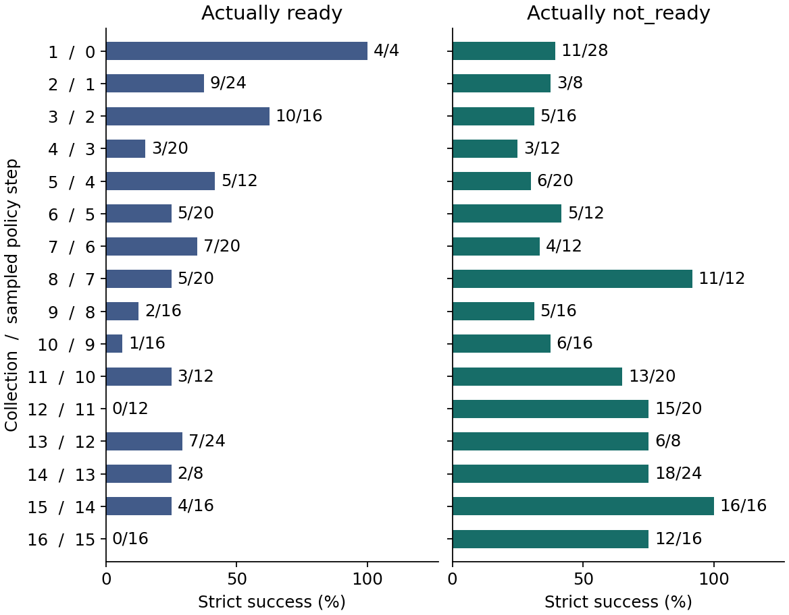
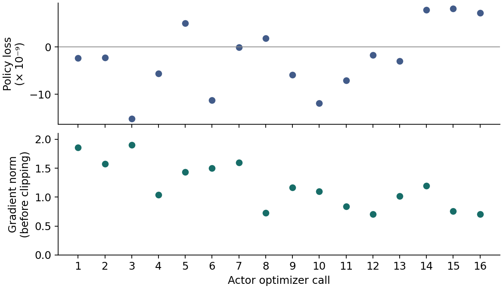

# 7. Read the experiment results

In the synthetic example in [Chapter 2](02-follow-one-calculator-task.md), the calculator returned 36 for `(7+5)*3`. The model still had to put the answer in a form the scorer could read. Now imagine saving the policy, loading it on a fresh worker and scoring it on 64 questions. **Which questions can the trained agent solve that its starting policy could not?** The calculator study lets you compare six runs. The recovery-readiness experiment asks a harder question. If the training pipeline works and the total score rises, can the policy still become less useful to someone who needs its help?

Run every command in this chapter **from the root of the public checkout**. The calculator check uses Python 3.12 and its standard library. The recovery figures use Python 3.12 and `uv`. On first use, `uv` installs Matplotlib 3.10.8 and its dependencies in a separate script environment. With those packages cached, add `--offline` after `uv run` to work offline. Each command reads committed results. You can also read the figures directly in the chapter.

## What counts as solving a calculator question?

Accuracy counts how many of the 64 development questions received reward 1 under the frozen answer extractor and numeric scorer. Both arithmetic and answer formatting can affect that score.

Study **`agl-explore-20-v1-r03`** ran at source **`5fb6adfd48ee245509f7dff3ab1d849fcf707d86`**. Each arm starts from the prepared `meta-llama/Llama-3.2-3B-Instruct` model before this lab's RL. Here **baseline** means an evaluation of the starting actor in the same harness. Earlier chapters also used “baseline” for a number subtracted when computing an advantage. In the results table, look for a score out of 64.

| Quantity | Correct denominator |
|---|---|
| Available training pool | 256 questions |
| One study collection | Eight question presentations, four real rollouts each: 32 trajectories |
| One study run | 20 actor calls, 160 question presentations, 640 trajectories |
| One PPO-MC study run | Additionally 20 critic calls |
| Six study runs | 3,840 trajectories; 120 actor calls and 60 critic calls |
| Study stages | 18: baseline, training and checkpoint-eval for each run |
| Qualification | Seed 9101, two steps per arm, six additional stages; excluded from study results |
| Evaluation | Reused, non-fresh 64-question development panel |

The 640 trajectories are not 640 unique questions. Twenty updates are not 20 dataset epochs. Reusing the panel across six runs does not create 384 independent test questions. Phase 1 results and earlier failed attempts are separate records.

A **seed** helps set the sequence of random choices in a run. In this comparison, the two methods for seed **2001** trained on matching batches of questions. The same pairing holds for **2002** and **2003**. Python/NumPy/Torch, sampling, optimizer and row-batching streams are algorithm-specific; PPO also has a critic initialization stream. Pairing does not promise identical continuations, token counts, compute budgets or bitwise results.

## Preserve every baseline and paired outcome

**Predict.** GRPO finished seed 2001 six answers ahead of PPO-MC. Did it also *gain* six more answers during training? Run the public checker to see each model's starting point.

```bash
python3 scripts/check_phase2_results.py
```

The first two lines show `27/64 -> 36/64` and `26/64 -> 30/64`. Expect six run lines, two means and a pass for 12 artifact hashes, 24 stage summaries, six runs and three contrasts. A change of one answer out of 64 is 1.5625 percentage points (pp).

| Algorithm | Seed | Baseline correct | Final reload correct | Improvement, percentage points |
|---|---:|---:|---:|---:|
| GRPO | 2001 | 27/64 | 36/64 | +14.062500 |
| PPO-MC | 2001 | 26/64 | 30/64 | +6.250000 |
| GRPO | 2002 | 27/64 | 30/64 | +4.687500 |
| PPO-MC | 2002 | 25/64 | 34/64 | +14.062500 |
| GRPO | 2003 | 26/64 | 34/64 | +12.500000 |
| PPO-MC | 2003 | 26/64 | 34/64 | +12.500000 |

| Algorithm | Mean baseline | Mean final | Mean improvement |
|---|---:|---:|---:|
| GRPO | 41.666667% | 52.083333% | +10.416667 pp |
| PPO-MC | 40.104167% | 51.041667% | +10.937500 pp |



Read the two endpoints of each line as the baseline and the independent step-20 reload. The connecting line pairs those measurements. Only the endpoints were evaluated. Some labels in the historical SVG overlap, especially the two 34/64 scores for seed 2003. The table above gives the exact counts. [Per-seed results](../../evidence/phase2-r03/per_seed_results.csv) · [Figure provenance](../../evidence/phase2-r03/figures/INDEX.md)

**Work the first pair.** For the *final-score contrast*, subtract the final counts, then convert to percentage points. For seed 2001 that gives `100 × (36 − 30) / 64 = 9.375` pp. For the *difference in improvements*, first subtract each run’s own baseline. GRPO gained 9 answers and PPO-MC gained 4. The difference is 5 answers, or 7.8125 pp. GRPO started one answer ahead.

| Seed | GRPO minus PPO final, pp | Difference in improvements, pp |
|---|---:|---:|
| 2001 | +9.375000 | +7.812500 |
| 2002 | -6.250000 | -9.375000 |
| 2003 | 0.000000 | 0.000000 |

Across the three pairs, GRPO had the higher mean final score (+1.041667 pp) and PPO-MC had the larger mean gain (GRPO minus PPO-MC was −0.520833 pp). Both are possible because the starting scores differed. The direction also varies by seed. Three pairs on the same development questions leave algorithm superiority, equivalence and performance on fresh questions unresolved. [Paired contrasts](../../evidence/phase2-r03/paired_differences.csv)

**Try another pair.** Both seed-2003 reloads scored 34/64. How many questions would you see change from solved to unsolved or vice versa if you switched agents? Read the four final-case columns of the paired CSV. They give 27 solved by both, seven only by GRPO, seven only by PPO-MC and 23 by neither. Switching agents changes the outcome on **14** questions even though the totals tie. [Per-case overlap by seed](../../evidence/phase2-r03/paired_differences.csv)

## What did the calculator critic predict?

[Chapter 5](05-ppo-mc-step-by-step.md) introduced the critic as a second model that predicts the eventual return. The audit compared predictions **before each update** with the observed returns on that collection’s generated tokens. Mean squared error (MSE) averages the squared prediction errors. Smaller is better. For each PPO-MC seed, pre-update MSE was lower on its last collection than on its first.

**Predict.** Would falling MSE be enough to recommend using this critic? From the repository root, read the three audit rows with a shell and `sed`. The first and last MSEs and the final comparison column are excerpted below.

```bash
sed -n '/^| PPO seed | Pre-update MSE/,/^$/p' evidence/phase2-r03/SCIENTIFIC_ANALYSIS.md
```

| Seed | First → last pre-update MSE | Collections beating the earlier-data constant |
|---|---:|---:|
| 2001 | 4.073710 → 0.189495 | 0/19 |
| 2002 | 2.447244 → 0.151124 | 0/19 |
| 2003 | 3.163390 → 0.376402 | 0/19 |

**Would one number have done better?** After the first collection, a simple predictor can give every token the same prediction, the mean return from earlier rollouts. It had lower error on **all 57 comparable collections**. There are 19 comparisons per seed because the first collection has no earlier returns. Explained variance asks how much of the variation in returns the predictions capture. All 51 defined observations were negative (the errors varied more than the returns). Nine collections had constant targets, so explained variance was undefined. Those results describe this critic on these runs. They do not tell us what caused an actor’s score or how PPO would perform elsewhere. [Scientific analysis and critic table](../../evidence/phase2-r03/SCIENTIFIC_ANALYSIS.md#training-signal-and-critic-behavior)

The scorer also depended on answer formatting. Across the three seeds, the number of episodes missing the answer marker fell from 77 to 2 for GRPO and from 81 to 16 for PPO-MC, each out of 192 episodes per endpoint. Every missing-marker episode earned zero. Better formatting may have contributed to the gains. The records do not isolate its share. Tool errors have a different denominator again: one episode can contain several tool calls and can recover after a call fails. [Calculator audit](../../evidence/phase2-r03/SCIENTIFIC_ANALYSIS.md)

Eight calculator GRPO updates had only constant-reward groups. Their current policy gradients were zero and the optimizer still ran. In the asset-status qualification the corrected harness and final-answer procedure already scored 64/64 at baseline in both arms. Both reloads also scored 64/64. A harness can change what the agent manages to complete before the first weight update. [Calculator closeout](../PHASE2_CLOSEOUT_2026-11-15.md) · [Asset-status qualification](../PHASE3_QUALIFICATION_2026-11-24.md)

## What did those six calculator runs use?

**Predict.** The study used two worker lanes. If you add the seconds for every worker, will that equal the time someone waited for the study? Use Python 3.12 from the checkout root to add the six study rows. Each row covers one run’s baseline, training and reload. The checkpoint column counts bytes in the files saved for its actor and, for PPO-MC, its critic. [Per-seed CSV](../../evidence/phase2-r03/per_seed_results.csv)

```bash
python3 - <<'PY'
import csv

with open("evidence/phase2-r03/per_seed_results.csv", newline="") as f:
    runs = list(csv.DictReader(f))
worker_seconds = sum(float(run["elapsed_time_seconds"]) for run in runs)
role_bytes = sum(int(run["checkpoint_bytes"]) for run in runs)
print(f"{len(runs)} runs: {worker_seconds:.3f} worker-seconds")
print(f"{role_bytes:,} checkpoint role-file bytes ({role_bytes / 2**30:.3f} GiB)")
PY
```

| Your sum | How to read it |
|---|---|
| 6 runs, 19,120.608 worker-seconds | Each worker clock includes loading, execution and receipt work. Some clocks ran at the same time. The study supervisor measured 11,287.051 seconds of elapsed wall time. Adding that to the worker total would count overlapping time again. Neither clock gives provider-billed seconds. |
| 356,589,684,584 bytes (332.100 GiB) | One GiB is 1,073,741,824 bytes. This sum covers the six checkpoints’ role files. Total storage occupancy also depends on logs, other artifacts and temporary files. |

**Can you price seed 2001 from those numbers?** At the November 15, 2026 billing snapshot, the provider attributed USD 34.33868457 to the whole study app and USD 5.76491115 to the separate qualification app, or USD 40.10359572 combined. Dividing the study charge by six would spread the charge evenly by assumption. The provider supplied no per-seed split. The snapshot also leaves later adjustments and storage charges unresolved. A future run needs a separate estimate using its own resources, duration, retention and applicable prices. [Resources, costs and hosted reconciliation](../../evidence/phase2-r03/SCIENTIFIC_ANALYSIS.md#resources-costs-and-hosted-reconciliation)

**Try one change.** Sum `training_elapsed_seconds` in place of `elapsed_time_seconds`. Now the clock covers only the six training stages, including collection and worker overhead. Expect **14,064.047 worker-seconds**. The checkpoint byte sum stays the same.

## Recovery readiness on the same 24 cases

Suppose the user wants to recover an asset from a backup. The agent checks an inventory, decides whether a usable backup exists at the requested time, and cites the records supporting its answer. A usable run succeeded, passed its integrity check and falls within the policy's age limit. The verifier knows the **actual class** from the inventory. A strict success earns 1 only when the whole answer meets the contract, including its decision and evidence.

The recovery GRPO pilot **P02**, seed 2001, executed source `17889f37651d57653cfc0dbe12d06304ac27371a`. It evaluated the base on 24 development cases, sampled 512 training attempts, then loaded the step-16 checkpoint on a fresh worker and evaluated the same 24 cases. All 560 episodes were admitted and their rewards confirmed. The two development evaluations used greedy decoding, choosing the highest-scoring next token. P01 was a separate allocation whose reload was interrupted. All the figures below use P02. [Pilot closeout](../PHASE4C_FUNCTIONAL_PILOT_CLOSEOUT.md)

**Predict.** Strict success rose from 9/24 to 12/24. Would you deploy this checkpoint to help someone *find a usable backup*? Split the score by what was actually in each inventory.

```bash
uv run --no-project --script scripts/plot_p02_lesson.py development
```



Each bar counts complete, strictly correct answers. The last pair pools the two equally sized classes. The command also prints **12/24 correct decisions at both endpoints**. At baseline that was nine correct ready decisions and three correct rejections. At reload **all 24 decisions were `not_ready`**. The agent correctly rejected all 12 unusable inventories and missed every usable one. [Paired development records](../../evidence/phase4c-functional-pilot/diagnosis/development.json)

### Follow the same case through both evaluations

Read across a row for the outcome of the *same* case at reload. Each case contributes to exactly one cell.

| Strict reward at baseline | Failed at reload (0) | Succeeded at reload (1) |
|---|---:|---:|
| Failed (0) | 6 retained failures on ready cases (3 decisions got worse) | 9 gains, all on not-ready cases |
| Succeeded (1) | 6 regressions, all on ready cases | 3 retained successes, all on not-ready cases |

Nine gains minus six regressions accounts for the net gain of three. But look inside the six retained failures. On three of them the base said `ready` correctly and cited a usable backup **plus stale backups**. One bad citation was enough to lose strict reward. At reload it said `not_ready` and cited no runs. For a negative answer the observed complete inventory and an empty list satisfied the evidence check. The verifier also checked whether a usable run existed, so it rejected the decision. The other three retained failures missed a usable backup at both endpoints. [Case-by-case diagnosis](../PHASE4C_PILOT_LEARNING_DIAGNOSIS.md#greedy-development-replay)

**Inspect one case.** Search the paired records for `c-92516b687c`, the first hidden regression printed by the command. Compare `decision_correct`, `evidence_correct` and `reward` in `base` and `reload`. They change from `true, false, 0` to `false, true, 0`. Across all 24 pairs, evidence correctness *conditional on the answer's decision* went from 12/24 to 24/24. Every false negative still earned zero. A user looking for a usable backup would have lost six strictly successful answers and three more correct decisions. [Verifier](../../experiment/recovery_task.py) · [Summary](../../evidence/phase4c-functional-pilot/diagnosis/summary.json)

## Which sampled successes supplied a reward contrast?

During training the policy sampled four attempts at each question. [Chapter 4](04-grpo-step-by-step.md) computed an advantage by subtracting the group mean reward and scaling by the group's spread. **Predict.** If all four answers succeed, how many of those four get positive advantage?

```bash
uv run --no-project --script scripts/plot_p02_lesson.py groups
```



Each class had 64 questions and 256 trajectories. The bars count **questions** grouped by the four rewards. The last two columns below count **individual trajectories**.

| Actual class | All zero | Mixed | All one | Strict successes | Positive-advantage trajectories |
|---|---:|---:|---:|---:|---:|
| ready | 30 | 32 | 2 | 67/256 | 59/256 |
| not_ready | 6 | 44 | 14 | 139/256 | 83/256 |

**Answer.** All four successes in an all-one group equal their group mean. Each gets zero advantage. The same holds for four failures in an all-zero group. Only the 76 mixed groups out of 128 supplied a relative reward contrast. Within a mixed group, a success is above the mean and a failure below it. All four attempts remain in the collection. The helper reads group types from the collection records and counts positive reconstructed advantages directly in the training table. [Collections](../../evidence/phase4c-functional-pilot/diagnosis/collections.json) · [Training trajectories](../../evidence/phase4c-functional-pilot/diagnosis/training.csv)

**Check the other class.** Starting from 139 strict successes on actually not-ready questions, how many came from groups in which success earned zero advantage? Four times 14 gives 56, leaving 83 with positive advantage. This is a count of opportunities to favor an attempt relative to its peers. A count alone cannot tell you how far any particular model weight moved.

## Which policy answered the training questions?

**Predict.** Collection 1 contains four ready successes and eleven not-ready successes. Which class has the higher success *rate*? Print the numerator and denominator for each class in all sixteen collections.

```bash
uv run --no-project --script scripts/plot_p02_lesson.py collections
```



Read the first row as **collection 1, policy 0**. There was one ready question (4/4 successes) and seven not-ready questions (11/28 successes). The ready class had the higher rate, yet that one all-one ready group supplied zero relative advantage. Each row contains eight new training questions and 32 sampled attempts. Collection *k* used the weights from policy step *k − 1*. Its actor update produced policy step *k* for the next collection. [Per-collection data](../../evidence/phase4c-functional-pilot/diagnosis/collections.json)

**Try rows 12 and 13.** Ready outcomes went from 0/12 to 7/24. Does this locate a step at which the model regained the ability to find backups? The questions, the number in each class, the model weights and the sampled responses all changed. These fractions describe the samples collected for training. The only greedy measurements on the fixed development panel were baseline and step 16. Even collection 16 sampled policy 15.

Pooling the first eight collections and then the last eight gives a larger sample. Ready strict success fell from 48/136 to 19/120. Not-ready strict success rose from 48/120 to 91/136. These are sampled training outcomes on different questions. [First-half and second-half counts](../PHASE4C_PILOT_LEARNING_DIAGNOSIS.md#sampled-training-signal)

A possible explanation for the terminal preference is that a correct ready answer must find a usable witness *and* omit every stale citation. A negative answer can give an empty list after observing the required records. The answer rules and the unequal reward opportunities are observed. Attributing the terminal decisions to that asymmetry is a **hypothesis**. One proposed intervention would teach witness selection from demonstrations and check both classes separately. It remains deferred, with no full-size behavioral result. [Diagnosis and proposed intervention](../PHASE4C_PILOT_LEARNING_DIAGNOSIS.md#proposed-next-intervention)

## What do sixteen optimizer calls establish?

**Predict.** At update 3 the scalar policy loss was about −0.000000015. Would you expect its gradient to be nearly zero too? Read the two panels vertically at call 3.

```bash
uv run --no-project --script scripts/plot_p02_lesson.py updates
```



Each dot is one recorded update. The upper axis is in billionths of a loss unit. The lower axis gives the length of the gradient vector before clipping. The command prints losses from −1.52 × 10⁻⁸ to +8.15 × 10⁻⁹ and norms from 0.708 to 1.901. Call 3 had the largest norm, about 1.901. [Sixteen update receipts](../PHASE4C_FUNCTIONAL_PILOT_CLOSEOUT.md#update-evidence)

**Why can that happen?** The loss is one number evaluated at the current weights. Its gradient describes how that number changes as each weight moves. Here the trainer took one update per collection. Before the update, the actor assigned nearly the same probabilities as its old policy. The positive and negative centered advantages could cancel in the *value* of the loss. The sampled tokens have different derivatives with respect to the weights, so their contributions to the *gradient* can survive that cancellation. [Chapter 4 worked calculation](04-grpo-step-by-step.md) · [Recorded optimizer diagnosis](../PHASE4C_PILOT_LEARNING_DIAGNOSIS.md#what-the-optimizer-measurements-mean)

**Try reading call 3 as a behavioral result.** How many extra ready cases did that gradient help the policy solve? There was no greedy development evaluation at step 3. A norm measures magnitude and contains no class-specific success score. The optimizer receipts show that all sixteen calls ran. The matching checkpoint inventory and distinct reload worker show that the saved policy could be loaded and evaluated. The 24 paired answers tell you what that policy did.

The recorded `actor/ppo_kl` compares the actor’s log probabilities with its recomputed old probabilities **within that update**. It and both actor clipping fractions were zero on all sixteen updates. Measuring cumulative divergence would require a comparison to a fixed reference such as the base model. Reference/base KL, entropy and intermediate greedy development scores are unavailable here. [P02 diagnosis](../PHASE4C_PILOT_LEARNING_DIAGNOSIS.md#what-the-optimizer-measurements-mean)

## Reproduce the figures from the public checkout

To regenerate all four P02 figures together, run the command below. It prints the counts and writes the PNGs under `docs/learning/figures/`. The script uses the committed diagnosis tables produced after execution. The original raw-trace replay used additional retained evidence. The calculator figure is the historical SVG distributed with its manifest and checked by the calculator command above. [Plotting helper](../../scripts/plot_p02_lesson.py) · [Public source map](source-map.md)

```bash
uv run --no-project --script scripts/plot_p02_lesson.py
```

Continue to [Chapter 8 · Reproduce and operate](08-reproduce-and-operate.md) for the route from offline checks to a reader-owned experiment.
