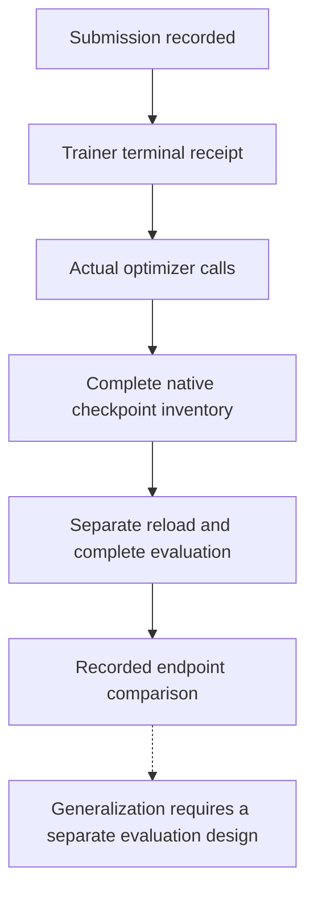

# 8. Reproduce and operate within scope

**Opening question: What can you verify without credentials, and what requires a separate decision?**

A useful reproduction claim states exactly what was checked. Recomputing a mean, validating a stored hash, replaying raw tokens and training a new model are different tasks. Begin with checks that use the committed repository alone.

## Two credential-free checks

From the repository root, with Python 3.12 and its standard library:

```bash
python3 experiment/cpu_accounting_demo.py
python3 scripts/check_phase2_results.py
```

The first prints synthetic row-versus-rollout arithmetic: row mean changes from 5 to 3.5 after fragmentation while the equal-rollout token mean remains 5. It does not measure learning.

The second verifies 12 listed artifact hashes, six study results, three signed contrasts and 24 derived stage summaries. It recomputes GRPO's mean 41.666667% to 52.083333% and PPO-MC's 40.104167% to 51.041667%. It checks that recorded final reloads use distinct worker IDs and matching checkpoint identities. Its final scope statement is crucial: derived CSV consistency does not revalidate raw trajectories or model/data/tensor bytes.

The inline exercises in Chapters 4 and 5 are also standard-library-only. No package installation, GPU dependency download, inference, cloud configuration or training launch is needed for this reader path.

## Match each claim to its evidence



Each box requires its own evidence; an earlier box does not automatically prove the later ones. A provider function can finish successfully while returning a failed study outcome. A directory named like a checkpoint does not prove that all role files are present.

| Activity | Inputs and scope |
|---|---|
| Synthetic arithmetic | Committed demo or inline numbers; verifies the stated calculation |
| Derived-evidence checking | Selected CSVs, SVG and manifest; checks internal consistency and listed byte identities |
| CPU backend integration tests | Already prepared compatible pinned CPU environment; exercises backend paths within its documented limits |
| Raw trace/tensor verification | Authorized raw records, frozen model/data/checkpoint bytes and reviewed comparison procedure |
| New paid cold-build training | Separately approved source/data plan, services, licensed model access, capacity, costs and completion gates |
| Public readiness | Separate history/privacy, licensing, redistribution, portability and visibility review |

Optional CPU backend tests are described in the [matched backend document](../PHASE2_MATCHED_BACKEND.md). Its preparation command downloads dependencies. It is not part of these prose exercises, and a passing CPU test is not GPU qualification.

## Existing runbooks and publication boundaries

For new reader-owned execution, use the [canonical reader training procedure](../READER_TRAINING.md). The reference Llama/calculator workflow passed live operational, integration, checkpoint and fresh-worker evaluation-reload checks on the [recorded configuration](../READER_QUALIFICATION_2026-11-19.md), for both GRPO and PPO-MC. This includes baseline evaluation and two-update training execution. Its execution identities are separate from the completed release and historical results; later documentation and merge commits did not produce the live run.

GRPO had 0/16 informative reward groups and no observed task-directed policy-gradient signal. PPO-MC made nonzero updates, but the short run did not establish useful critic convergence or reliable improvement. Evaluation-only reload does not qualify resumed training. Alternate-model/task work remains open; this run does not universally qualify future environments or cold builds.

The [historical experiment runbook](../../experiment/README.md), [matched backend](../PHASE2_MATCHED_BACKEND.md), [exploratory protocol](../PHASE2_EXPLORATORY.md) and [ten-way runbook](../PHASE2_TENWAY.md) preserve their original scopes. New execution requires separately authorized access, source identity, data/model rights, capacity and budget. Cached-image r03 success does not establish a fresh cold build. The formal ten-job campaign remains unexecuted/unqualified; its untouched-holdout route is not the reused-panel r03 study.

The [evidence index](../../evidence/phase2-r03/EVIDENCE_INDEX.md) lists retained private raw/checkpoint locators. They are not included artifacts or paths promised to exist in a clone. No backup, tensor download, deletion or model redistribution follows from reading this guide.

This educational snapshot excludes the original private Git history. Scoped licenses and notices are included; the [release plan](../PUBLIC_RELEASE_PLAN.md) records publication verification. Its [source map](source-map.md#public-source-representations) supplies publicly usable implementation representations. The recorded reader-owned validation does not establish access to private historical artifacts; that remains a separate, unqualified operation.

## Exact source and evidence limits

[`cpu_accounting_demo.scenario`](https://github.com/amulyaparthasarathy/agent-lightning-grpo-ppo/blob/89fe32f92f29209803c13264baed951713741d42/experiment/cpu_accounting_demo.py#L14) is an existing synthetic fixture. [`check_phase2_results.main`](https://github.com/amulyaparthasarathy/agent-lightning-grpo-ppo/blob/89fe32f92f29209803c13264baed951713741d42/scripts/check_phase2_results.py#L33) maps to the post-execution verification revision because it was added after the executed source. [`checkpoint_identity`, `verify_checkpoint` and `complete_stage`](https://github.com/amulyaparthasarathy/agent-lightning-grpo-ppo/blob/89fe32f92f29209803c13264baed951713741d42/experiment/matched_launch.py#L158) define the recorded runtime requirements; the offline checker reads their derived summaries rather than rerunning them.

The [source map](source-map.md) records editorial context, historical discrepancies and unavailable series; it does not publish editorial packet hashes. The [learning index](README.md) records this documentation revision's verification scope separately from the historical audit.

## Offline exercise and answer

**Exercise:** Both offline commands pass. Can you now claim that all remote checkpoint tensors were independently rehashed, that training reproduces from a cold build, or that the repository is ready to become public?

**Answer:** None of those follows. You checked synthetic arithmetic and committed derived evidence. Raw tensor identity, cold-build execution and publication readiness each require different inputs and separately reviewed work.

Next: use the [glossary](glossary.md) to review the vocabulary, then the [source map](source-map.md) for deeper code reading, or return to the [learning index](README.md).
