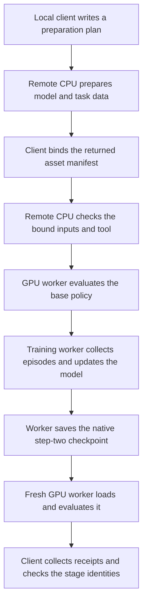

# 8. Run and adapt an agent-training workflow

You have seen how one calculator episode reaches an optimizer. Suppose you want to check the arithmetic, find out what happened in a real experiment, or train a model to use a different tool. Each question has a different starting point.

| Reader path | Start here | What you take away |
|---|---|---|
| Learn the mechanics | Run the synthetic example below, then try the [asset harness exercise](../TASK_ADAPTATION.md#run-the-local-checks). | Explain why a split episode keeps its weight and how a tool observation becomes part of the next model input. |
| Inspect a completed experiment | Run the second check below and read the [six measured runs](07-read-the-experiment-results.md#preserve-every-baseline-and-paired-outcome). | Reproduce the published calculation from files in your checkout. |
| Run your own experiment | First make an [offline practice plan](../READER_TRAINING.md#try-a-plan-without-an-account). Continue to the funded steps only with your own accounts, model access and budget. | Collect new episodes, train, save a checkpoint and evaluate that checkpoint on a fresh worker. |

## Two credential-free checks

Use a Unix terminal, Python 3.12 and the [repository checkout](../../README.md#credential-free-offline-quick-start). Start in its root, where you can see `experiment/`, `scripts/` and `evidence/`. Both commands use the standard library. Once you have the checkout, neither needs a download, an account or a GPU.

**1. Predict what happens when one attempt is split.** Two synthetic attempts, A and B, have mean token losses of 2 and 8. A is stored first as one row, then as three equal-length rows with means 1, 2 and 3. If each row gets one vote, which attempt gains influence?

```bash
python3 experiment/cpu_accounting_demo.py
```

Read the `unsplit` and `fragmented` sections of the printed JSON.

| Representation | Rows for A, B | Mean over rows | Mean over the two attempts |
|---|---|---:|---:|
| Unsplit | 1, 1 | 5 | 5 |
| Fragmented | 3, 1 | 3.5 | 5 |

A now gets three of four votes in the row mean. Averaging within each attempt first gives A half the total weight in either representation. The numbers in this fixture are supplied token losses. For the masks that determine which positions count, see [Chapter 3](03-trajectories-tokens-and-fragments.md#equal-weight-for-each-real-rollout).

**2. Reproduce a measured result.** Look at the final GRPO scores for seeds 2001, 2002 and 2003 in the [committed results](../../evidence/phase2-r03/per_seed_results.csv). The model solved 36, 30 and 34 of the same 64 development questions. Predict the mean across the three runs using $100(36+30+34)/(3\times64)$ percent. Then run the checker.

```bash
python3 scripts/check_phase2_results.py
```

| Algorithm | Printed mean baseline | Printed mean final |
|---|---:|---:|
| GRPO | 41.666667% | 52.083333% |
| PPO-MC | 40.104167% | 51.041667% |

Expect `PASS: 12 artifact hashes; 24 stage summaries; six runs; three contrasts.` The 24 summaries include six qualification stages. Only the six 20-update study runs enter these means. The checker compares recorded checkpoint identities and worker call IDs. Rehashing the actual model tensors would require checkpoint bytes beyond the public checkout. If a script cannot be found, check your working directory. If a hash or a count fails, inspect the named evidence file against the committed revision before interpreting the numbers. [Checker source](../../scripts/check_phase2_results.py)

**Try one change on paper.** Use only seed 2001. Its final GRPO accuracy is 36/64, or 56.25%. Removing two seeds changes which runs you are describing. Even the three-run mean measures performance on just one reused question panel.

## From a client plan to a served checkpoint

A *plan* records the source revision, task, assets, resources and expected stages for one allocation. A *receipt* records evidence that an operation actually happened. Predict which receipt would tell you that a saved policy can answer a new request after the training worker has exited.



The diagram follows one algorithm through a full qualification. Your local terminal sends the requests and reads the evidence. On Modal the harness builds prompts, executes tools and posts rewards. Agent Lightning connects the interaction to the trainer, VERL updates the trainable weights, and vLLM serves the refreshed actor. The two algorithms share this route. PPO-MC also trains and saves a critic. The fresh-worker evaluation receipt ties a complete panel to the saved checkpoint and a different worker. Its optimizer count should be zero. [Chapter 6 reload exercise](06-one-complete-training-update.md#check-that-the-saved-actor-served-the-independent-evaluation)

Follow the [reader procedure](../READER_TRAINING.md) for the commands, receipts and stop conditions. The recorded short calculator workflow completed both algorithms. GRPO had zero informative groups in sixteen, so every group lacked the reward contrast that supplies its task-directed gradient. The independently reloaded PPO-MC actor scored 28/64 after a 27/64 baseline. These observations establish that the workflow ran on the recorded configuration. They leave the effect of training on fresh questions open. [Calculator qualification](../READER_QUALIFICATION_2026-11-19.md#live-gpu-outcomes)

## Change the agent's job

Suppose the question changes from “what is (7+5)*3?” to “what is the backup health of asset-281?” A calculator result needs a numerical answer. An asset lookup returns several facts and the final answer must identify the requested asset and report both status fields. The trainer can still use one terminal reward per completed attempt. The work is in specifying what the agent sees, what the tool accepts and how the harness establishes a trustworthy outcome.

Follow the [calculator-to-asset walkthrough](../TASK_ADAPTATION.md#the-two-workflows). Run the local tool, inspect a scripted continuation and change one answer field. Then decide which attempts belong in a four-member training group. The [asset qualification](../PHASE3_QUALIFICATION_2026-11-24.md) shows what happened with a real model after the harness correction. Both baseline and reload scored 64/64, leaving no measured improvement for training to explain.

Return to the [learning index](README.md) or use the [source map](source-map.md) to locate the implementation and the original execution evidence.
